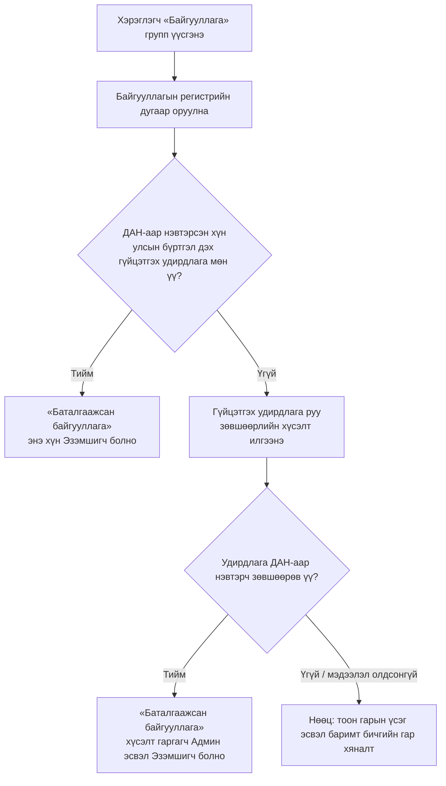

# Судалгаа: SSO дээрх групп (гэр бүл, байгууллага, найз, бусад), хүүхэд нэмэх, байгууллага баталгаажуулах

> Огноо: 2026-10-26 · Хариуцагч: business-analyst · Холбоотой: «Групп, байгууллагын бүртгэл» эпик, NAV-024–NAV-031 (ялангуяа [NAV-029](../../requirements/stories/NAV-029-org-verification-dan-mn.md), [NAV-031](../../requirements/stories/NAV-031-org-ownership-payment-management-spike-mn.md))
> Төлөв: эхний ээлжийн судалгаа (desk research). Гадны үйлчилгээний алхмууд өөрчлөгдөж болох тул хэрэгжүүлэхээс өмнө албан ёсны эх сурвалжаас дахин шалгана.

---

## 1. Хураангуй

1. **Hamuga ID-тай яг ижил «нэг SSO дотор 4 төрлийн групп» загвартай нийтэд нээлттэй жишээ олдсонгүй.** Томоохон SSO-ууд (Google, Apple, Microsoft) **гэр бүлийн групп**-ийг хувийн бүртгэл дотор хийдэг. Харин **байгууллага**-ыг тусдаа бүтээгдэхүүн, тусдаа консолоор хийдэг (Google Workspace, Apple Business Manager, Meta Business). «Найз» групп SSO түвшинд бараг байдаггүй. Энэ нь аппын түвшинд (Google Maps-ийн байршил хуваалцах, Apple Find My) хүмүүстэй тус тусад нь хуваалцах хэлбэрээр байдаг.
2. **Hamuga ID-д хамгийн ойр загвар нь Сингапурын Singpass + Corppass.** Иргэний үндэсний ID (Singpass ≈ ДАН) дээр суурилж, хуулийн этгээдийн бүртгэлээс (UEN ≈ улсын бүртгэлийн дугаар) албан тушаалтныг автоматаар тодорхойлж, тэр нь байгууллагын админыг томилдог.
3. **Хүүхэд нэмэх:** Hamuga ID-д ДАН-аар хүүхдийн жагсаалт татаж холбох процесс **аль хэдийн бий** ([kids-guide](https://ictg.gitbook.io/hamuga-id/kids-guide)). Энэ нь Google/Apple-ийн загвараас илүү найдвартай, учир нь эцэг/эх–хүүхдийн холбоог төрийн бүртгэлээр баталгаажуулдаг. **Санал:** «Гэр бүл» групп нь энэ «Миний хүүхэд» холбоосыг дахин ашиглана. Хүүхдийг урилгаар нэмэхгүй.
4. **Байгууллага баталгаажуулах:** түвшинтэй загварыг санал болгож байна. **Түвшин 1** нь байгууллагын имэйлийн домэйн. **Түвшин 2** нь ДАН/хуулийн этгээдийн бүртгэлээр гүйцэтгэх удирдлагыг таниулах (Corppass загвар). Тоон гарын үсэг ба баримт бичгийн гар хяналтыг нөөц хувилбар болгоно. Эпикийн шаардлага 3-ын «админ руу код илгээх» нь **гишүүнийг** баталгаажуулдаг бөгөөд **байгууллагыг** баталгаажуулдаггүй, хоёр өөр асуудал.

---

## 2. Жишээ платформууд

### 2.1 Харьцуулалт

| Платформ | Группын төрөл | Хэн үүсгэх / удирдах | Гишүүн нэмэх арга | Хүүхэд | Баталгаажуулалт | Хязгаар |
|---|---|---|---|---|---|---|
| **Google Families / Family Link** | Гэр бүл | «Family manager» (үүсгэгч) | Имэйлээр урих | Эцэг/эх 13-аас доош насны хүүхдэд шинэ бүртгэл **үүсгэнэ**, эсвэл байгаа бүртгэлийг холбоно | Эцэг/эх өөрийн нууц үгээр баталгаажуулна | 6 гишүүн |
| **Apple Family Sharing** | Гэр бүл | «Organizer», нэмэлтээр Parent/Guardian | Урилга эсвэл «Invite in Person» | Organizer хүүхдийн бүртгэл үүсгэнэ. Зарим улсад насанд хүрсэн эсэхийг карт эсвэл иргэний үнэмлэхээр шалгана | Parental consent: төлбөрийн хэрэгсэл эсвэл баримт бичиг | 6 гишүүн |
| **Microsoft Family** | Гэр бүл | «Organizer» (олон байж болно) | Имэйл/утсаар урих, хүлээн авагч зөвшөөрнө | Хүүхдэд «Member» role, насанд хүрээгүйд насанд хүрэгчийн зөвшөөрөл | Насанд хүрэгчийн зөвшөөрөл | Нэг хүн зөвхөн **нэг** гэр бүлийн группт |
| **Singpass + Corppass** (Сингапур) | Байгууллага (хуулийн этгээд) | Улсын бүртгэлд бүртгэлтэй албан тушаалтан (Registered Officer) → Corppass Admin | Admin хэрэглэгч үүсгэж, үйлчилгээ тус бүрт эрх олгоно | — | **Төрийн бүртгэлээр автоматаар**: UEN олгогч байгууллага албан тушаалтны жагсаалтыг Corppass-д тогтмол дамжуулдаг | Админ ≤ 2, хэрэглэгч хязгааргүй |
| **Google Workspace** | Байгууллага | Супер админ | Админ хэрэглэгч үүсгэнэ | — | **Домэйн**: DNS-д TXT бичлэг (≤ 72 цаг) | — |
| **Apple Business Manager** | Байгууллага | Админ + тусдаа verification contact | Админ үүсгэнэ | — | **D-U-N-S дугаар** + Apple-аас хуулийн төлөөлөгч рүү утасдаж баталгаажуулна. Админ ба verification contact өөр хүн байна | — |
| **Meta Business verification** | Байгууллага | Business admin | Урилгаар | — | **Баримт бичиг** (улсын бүртгэлийн гэрчилгээ, татварын бүртгэл) + домэйн эсвэл утас/имэйлийн код. Хянах хугацаа 1–14 ажлын өдөр | — |
| **Kakao Developers (Biz app)** | Байгууллага (бизнес апп) | App Owner | — | — | Бизнес бүртгэлийн мэдээлэл. Зөвхөн Owner өөрчлөх хүсэлт гаргана, ≤ 3 ажлын өдөр | — |

### 2.2 Ажиглалтууд
- **Гэр бүлийн групп** бүх платформд ижил бүтэцтэй: нэг удирдагч (organizer/manager), хүүхдийг **удирдагч өөрөө үүсгэх эсвэл холбох**, насанд хүрэгчийг **урилгаар** нэмэх, гишүүдийн тоо бага (≈ 6).
- **Microsoft:** нэг хүн зөвхөн нэг гэр бүлийн группт байна. **Google:** зөвхөн family manager гишүүн нэмж, хасна. Эдгээр нь NAV-024 Нээлттэй асуулт 2, NAV-027-ийн хязгаарт хэрэгтэй жишиг.
- **Байгууллага** нь хаана ч энгийн «групп» биш, **тусдаа эрх зүйн субъект**. Үргэлж (a) байгууллага өөрөө хэн бэ, (b) хэн түүнийг төлөөлөх эрхтэй вэ гэсэн хоёр асуултад хариулдаг.
- **Apple-ийн «админ ≠ verification contact» дүрэм** нь нэг хүн өөрийгөө баталгаажуулахаас сэргийлдэг. NAV-031-д ашиглаж болох санаа.
- **«Найз» ба «Бусад»** групп SSO түвшинд жишээгүй. Тиймээс хөнгөн байлгах (баталгаажуулалтгүй, урилгаар, жижиг эрхтэй) нь зүйтэй.

---

## 3. Хүүхдийг хэрхэн нэмэх вэ

### 3.1 Hamuga ID-ийн одоогийн процесс ([kids-guide](https://ictg.gitbook.io/hamuga-id/kids-guide))

**A. Эцэг/эх хүүхдээ татаж холбох**
1. Эцэг/эх Hamuga ID-д нэвтэрнэ. Бүртгэл нь **ДАН-аар баталгаажсан (Level 2)** байх шаардлагатай.
2. «Миний хүүхэд» → «Хүүхэд бүртгэх».
3. Төрийн мэдээлэл солилцооны системийн зөвшөөрлийн цонхонд «Зөвшөөрөх»-ийг дарна.
4. Хүүхдийн жагсаалт ачаалагдана. **Ногоон** нь Hamuga ID бүртгэлтэй, **улаан** нь «ID-д бүртгэлгүй хүүхдийн мэдээлэл».
5. Бүртгэлтэй хүүхдийг сонгож «Холбох» → «Тийм». Бүртгэлгүй хүүхэд эхлээд Hamuga ID үүсгэх ёстой.

**B. 0–16 насны хүүхдийн баталгаажуулалт (эцэг/эхээр дамжуулан)**
1. Хүүхэд бүртгэл үүсгэж нэвтэрнэ.
2. «Хувийн мэдээлэл» → ДАН хэсэгт «Баталгаажуулах» → регистрийн дугаар оруулж «Шалгах».
3. Эцэг/эхийн мэдээлэл гарч, хүүхэд аль асран хамгаалагчаар баталгаажуулахаа сонгоно. Эцэг/эхийн Hamuga ID, утас, имэйл рүү хүсэлт очно.
4. Эцэг/эх **10 минутын дотор** зөвшөөрнө → хүүхдийн бүртгэл Level 2 болно.

**C. 16–18 насны хүүхэд (иргэний үнэмлэхтэй)** өөрөө ДАН эсвэл E-Mongolia аппын 6 оронтой кодоор (2 минут) баталгаажуулна.

**Холбосны дараа эцэг/эх харах зүйлс:** хүүхдийн хувийн мэдээлэл (овог, нэр, утас, имэйл, нэвтрэх нэр), ашигласан төхөөрөмжүүд, хүүхэдтэй холбогдсон хэрэглэгчид, холбогдсон системүүд.

### 3.2 Google / Apple / Microsoft-тай харьцуулалт

| Асуудал | Hamuga ID | Google / Apple / Microsoft |
|---|---|---|
| Эцэг/эх–хүүхдийн холбоог юугаар нотлох | **Төрийн бүртгэл (ДАН)**, хамгийн хүчтэй | Эцэг/эх өөрөө мэдүүлнэ. Төлбөрийн карт эсвэл иргэний үнэмлэхээр зөвхөн насанд хүрсэн эсэхийг шалгана |
| Хүүхдийн бүртгэлийг хэн үүсгэх | Хүүхэд өөрөө (эцэг/эх зөвхөн холбоно) | Эцэг/эх хүүхдэд бүртгэл **үүсгэж** чадна |
| Насны босго | 0–16 эцэг/эхээр, 16–18 өөрөө | 13 (улсаас хамаарна) |
| 18 нас хүрэхэд | Баримтад тодорхойгүй | Хяналт автоматаар суларна, хүүхэд группээс гарч болно |

### 3.3 «Гэр бүл» группт хамаарах санал
1. **Хүүхдийг урилгаар биш, «Миний хүүхэд» холбоосоор нэмэх.** «Гэр бүл» групп үүсгэхэд эцэг/эхийн холбогдсон хүүхдүүд «Нэмэх үү?» гэсэн санал болгох жагсаалтад гарна. Хүүхэд урилга зөвшөөрөх шаардлагагүй (эрх зүйн холбоо аль хэдийн баталгаажсан).
2. **Насанд хүрэгчдийг (эхнэр/нөхөр, өвөө/эмээ) урилгаар нэмэх** (NAV-026). Тэд хүлээн авна.
3. **Бүртгэлгүй (улаан) хүүхэд:** эцэг/эх хүүхдэд бүртгэл үүсгэх урсгал Hamuga ID-д одоогоор байхгүй. Google/Apple-ийнх шиг «Хүүхдэд бүртгэл үүсгэх» боломжийг ICT Group-тэй ярилцах шаардлагатай.
4. **18 нас хүрэх:** гэр бүлийн групп дэх хүүхдийн role автоматаар «Гишүүн» (насанд хүрсэн) болж, эцэг/эхийн хяналт (байршил гэх мэт) дахин зөвшөөрөл шаардах.
5. **Асран хамгаалагч хоёулаа:** хоёр эцэг/эх хоёулаа «Админ» байх (Apple-ийн Parent/Guardian, Microsoft-ийн олон Organizer).

---

## 4. Байгууллагыг хэрхэн баталгаажуулах вэ

### 4.1 Хоёр тусдаа асуудал
| Асуудал | Асуулт | Эпикийн шаардлага |
|---|---|---|
| **Байгууллагын баталгаажуулалт** | Энэ байгууллага бодитоор оршдог уу, түүнийг төлөөлж буй хүн эрхтэй юу? | 6 (ДАН), NAV-029 |
| **Гишүүнчлэлийн баталгаажуулалт** | Энэ хүн тухайн байгууллагын ажилтан мөн үү? | 3 (админ руу код), NAV-028 |

### 4.2 Арга бүрийн үнэлгээ

| # | Арга | Жишээ | Юуг нотлох | Давуу тал | Сул тал | Монголд хэрэгжих боломж |
|---|---|---|---|---|---|---|
| A | **ДАН + хуулийн этгээдийн бүртгэл**: регистрээр байгууллагын гүйцэтгэх удирдлагыг тодорхойлж, ДАН-аар нэвтэрсэн хүнтэй тааруулах | Singpass + Corppass | Байгууллага ба төлөөлөх эрх хоёуланг | Автомат, гар хяналтгүй, хамгийн найдвартай | ДАН-аас хуулийн этгээдийн мэдээлэл (улсын бүртгэл) авах эрх хэрэгтэй | **Тодруулах шаардлагатай.** e-Mongolia ба [e-business.mn](https://e-business.mn/home) хуулийн этгээдийн үйлчилгээ үзүүлдэг. Hamuga ID-д энэ сервис нээлттэй эсэхийг ICT Group-ээс асуух |
| B | **Хуулийн этгээдийн тоон гарын үсэг** (USB токен) | e-business.mn, e-Mongolia-д хуулийн этгээдээр нэвтрэх | Байгууллагыг | Хуулийн хүчинтэй, аль хэдийн олон байгууллагад байгаа | Токен, ESIGN клиент шаардлагатай; мобайлд хүндрэлтэй | Нөөц хувилбар (вебээр) |
| C | **Баримт бичиг гараар хянах** (улсын бүртгэлийн гэрчилгээ, татварын бүртгэл) | Meta, Kakao | Байгууллагыг | Ямар ч байгууллагад ажиллана | Гар ажил, 1–14 хоног, хуурамч баримтын эрсдэл | Нөөц хувилбар (ТББ, гадаадын байгууллага) |
| D | **Домэйн баталгаажуулалт** (DNS TXT) эсвэл байгууллагын имэйлийн домэйн | Google Workspace | Домэйн эзэмшил | Хурдан, автомат | Хуулийн этгээдийг нотлохгүй; домэйнгүй жижиг байгууллага олон | Ажилтныг автоматаар таних (NAV-025, NAV-028) |
| E | **Хуулийн төлөөлөгч рүү утасдах** | Apple Business Manager | Төлөөлөх эрх | Залилангаас хамгаална | Гар ажил | Том байгууллага, төлбөрийн эрх нээх үед |
| F | **Группын админ руу код илгээх** | — (эпикийн шаардлага 3) | **Гишүүнчлэлийг** | Энгийн | Байгууллагыг нотлохгүй | NAV-028-д хэвээр |

### 4.3 Санал: түвшинтэй баталгаажуулалт

| Түвшин | Нэр | Нөхцөл | Нээгдэх боломж |
|---|---|---|---|
| 0 | «Баталгаажаагүй» | Групп үүсгэсэн | Гишүүн урих, байршил хуваалцах |
| 1 | «Домэйн баталгаажсан» | Байгууллагын имэйлийн домэйн эсвэл DNS TXT (D) | Тухайн домэйны имэйлтэй ажилтнуудыг автоматаар санал болгох |
| 2 | «Баталгаажсан байгууллага» | ДАН + хуулийн этгээдийн бүртгэлээр гүйцэтгэх удирдлага таарсан (A); эсвэл тоон гарын үсэг (B), баримт бичгийн хяналт (C) | Байгууллагын POI, байгууллагын нэрийн өмнөөс төлбөр (NAV-030) |

Түвшин 2-ын урсгал (Corppass загвараар):

Энэ урсгал нь Hamuga ID-ийн 0–16 насны хүүхдийн «эцэг/эх рүү зөвшөөрлийн хүсэлт илгээх» загвартай ижил тул хэрэглэгчдэд танил бөгөөд кодын хувьд дахин ашиглах боломжтой.

---

## 5. Нээлттэй асуултууд (ICT Group / PO)

1. Hamuga ID-ийн ДАН холболтоор **хуулийн этгээдийн мэдээлэл** (регистр, нэр, гүйцэтгэх удирдлага, хувьцаа эзэмшигч) авах эрх бий юу, эсвэл нэмж хүсэх шаардлагатай юу? Энэ нь 4.3-ын Түвшин 2-ыг шийднэ.
2. Эцэг/эх **бүртгэлгүй хүүхдэд Hamuga ID үүсгэх** урсгалыг нэмэх үү (Google/Apple загвар)?
3. Хүүхэд **18 нас хүрэхэд** эцэг/эхийн холбоос юу болох вэ? (Одоогийн баримтад тодорхойгүй.)
4. Нэг хүн хэдэн «Гэр бүл» группт байж болох вэ? (Microsoft: 1, NAV-024 Нээлттэй асуулт 2)
5. Байгууллагыг төлөөлөх эрхийг гүйцэтгэх удирдлагаас өөр хүнд (нягтлан, IT админ) шилжүүлэх журам: Corppass-д Registered Officer админыг томилдог.
6. ТББ, гадаадын байгууллага, хувиараа бизнес эрхлэгч (ХХК биш) зэргийг хэрхэн баталгаажуулах вэ?

## 6. Дараагийн алхам
- 5.1-ийн хариуг ICT Group-ээс авч, NAV-029-ийн AC-г шинэчлэх.
- 3.3-ын саналыг NAV-024 / NAV-026-д тусгах («Гэр бүл» группт хүүхдийг «Миний хүүхэд»-ээс нэмэх).
- 4.3-ын түвшнийг NAV-027-ийн эрхийн матриц ба NAV-030-д тусгах.

## 7. Эх сурвалж
- Hamuga ID — [Хүүхэд бүртгэх заавар](https://ictg.gitbook.io/hamuga-id/kids-guide)
- Google — [Create and build your family group](https://support.google.com/families/answer/15077235); [Android Central: Family Link child account](https://androidcentral.com/how-create-google-account-your-kid-through-family-link)
- Apple — [Parental consent with Family Sharing](https://support.apple.com/102033); [Family Sharing & Privacy](https://apple.com/legal/privacy/data/en/family-sharing)
- Microsoft — [Add people to your family group](https://support.microsoft.com/help/4a07b974-8103-16ad-6ea2-46549ca19e03); [Family group roles and permissions](https://support.microsoft.com/account-billing/learn-about-family-group-roles-permissions-and-data-sharing-2d0764e1-5ec5-f6a1-6898-0bc18f71e318)
- Singapore Corppass — [How it works (GovTech)](https://www.developer.tech.gov.sg/products/categories/digital-identity/corppass/how-it-works); [IRAS CorpPass step-by-step guide](https://www.iras.gov.sg/irashome/uploadedFiles/IRASHome/e-Services/Businesses/Companies/CorpPass%20Step-by-Step%20Guide%20for%20Companies.pdf)
- Google Workspace — [Verify your domain with a TXT record](https://support.google.com/a/answer/183895)
- Apple Business Manager — [Enrollment and verification](https://support.apple.com/en-ca/guide/apple-business-manager-m/axmf62ad08b7/web)
- Meta — [Business verification (360dialog docs)](https://docs.360dialog.com/docs/waba-management/meta-business-verification)
- Kakao — [비즈 앱 전환](https://devtalk.kakao.com/t/how-to-switch-to-a-biz-app/56132); [사업자 정보 변경](https://devtalk.kakao.com/t/topic/72093/1)
- Монгол — [e-business.mn](https://e-business.mn/home); [Tridumkey: e-Mongolia-д хуулийн этгээдээр нэвтрэх](https://tridumkey.mn/emongolia/); [immigration.gov.mn: тоон гарын үсэг](https://immigration.gov.mn/mn/esign/)
