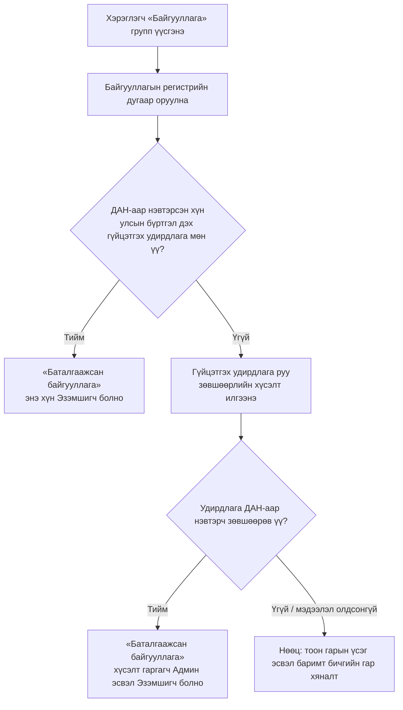

# Судалгаа: SSO дээрх групп (гэр бүл, байгууллага, найз, бусад), хүүхэд нэмэх, байгууллага баталгаажуулах

> Огноо: 2026-10-26 · Хариуцагч: business-analyst · Холбоотой: «Групп, байгууллагын бүртгэл» эпик, NAV-024–NAV-031 (ялангуяа [NAV-029](../../requirements/stories/NAV-029-org-verification-dan-mn.md), [NAV-031](../../requirements/stories/NAV-031-org-ownership-payment-management-spike-mn.md))
> Төлөв: эхний ээлжийн судалгаа (desk research). Гадны үйлчилгээний алхмууд өөрчлөгдөж болох тул хэрэгжүүлэхээс өмнө албан ёсны эх сурвалжаас дахин шалгана.

---

## 1. Хураангуй

1. **Hamuga ID-тай яг ижил «нэг SSO дотор 4 төрлийн групп» загвартай нийтэд нээлттэй жишээ олдсонгүй.** Томоохон SSO-ууд (Google, Apple, Microsoft) **гэр бүлийн групп**-ийг хувийн бүртгэл дотор хийдэг. Харин **байгууллага**-ыг тусдаа бүтээгдэхүүн, тусдаа консолоор хийдэг (Google Workspace, Apple Business Manager, Meta Business). «Найз» групп SSO түвшинд бараг байдаггүй. Энэ нь аппын түвшинд (Google Maps-ийн байршил хуваалцах, Apple Find My) хүмүүстэй тус тусад нь хуваалцах хэлбэрээр байдаг.
2. **Hamuga ID-д хамгийн ойр загвар нь Сингапурын Singpass + Corppass.** Иргэний үндэсний ID (Singpass ≈ ДАН) дээр суурилж, хуулийн этгээдийн бүртгэлээс (UEN ≈ улсын бүртгэлийн дугаар) албан тушаалтныг автоматаар тодорхойлж, тэр нь байгууллагын админыг томилдог.
3. **Хүүхэд нэмэх:** Hamuga ID-д ДАН-аар хүүхдийн жагсаалт татаж холбох процесс **аль хэдийн бий** ([kids-guide](https://ictg.gitbook.io/hamuga-id/kids-guide)). Энэ нь Google/Apple-ийн загвараас илүү найдвартай, учир нь эцэг/эх–хүүхдийн холбоог төрийн бүртгэлээр баталгаажуулдаг. **Санал:** «Гэр бүл» групп нь энэ «Миний хүүхэд» холбоосыг дахин ашиглана. Хүүхдийг урилгаар нэмэхгүй.
4. **Байгууллага баталгаажуулах:** түвшинтэй загварыг санал болгож байна. **Түвшин 1** нь байгууллагын имэйлийн домэйн. **Түвшин 2** нь ДАН/хуулийн этгээдийн бүртгэлээр гүйцэтгэх удирдлагыг таниулах (Corppass загвар). Тоон гарын үсэг ба баримт бичгийн гар хяналтыг нөөц хувилбар болгоно. Эпикийн шаардлага 3-ын «админ руу код илгээх» нь **гишүүнийг** баталгаажуулдаг бөгөөд **байгууллагыг** баталгаажуулдаггүй, хоёр өөр асуудал.
5. **Регистрээр баталгаажуулах (§4.4):** регистрээр байгууллага оршин байгааг шалгаад, төлөөлөх эрхийг ДАН-аар тааруулна. Хувь хүн татвар төлөгч бол ДАН-ы иргэнтэй шууд тааруулна. Хуулийн этгээд бол гүйцэтгэх удирдлагатай тааруулна. **PO-ийн шийдвэрээр (2026-10-26) бүх төрлийн байгууллага нэг ижил процессоор явна, нөөц арга байхгүй** (§4.8).
6. **Регистргүй бизнес (§4.5):** Google, Apple-ийн адил «бизнесийн цэг өмчлөх»-ийг байгууллагын баталгаажуулалтаас салгана. **ДАН Level 2 + бизнесийн утасны кодоор** цэгээ нотолж, засварыг Hamuga POI engine руу бичнэ (PO 2026-10-26, NAV-032).

---

## 2. Жишээ платформууд

### 2.1 Харьцуулалт

| Платформ | Группын төрөл | Хэн үүсгэх / удирдах | Гишүүн нэмэх арга | Хүүхэд | Баталгаажуулалт | Хязгаар |
|---|---|---|---|---|---|---|
| **Google Families / Family Link** | Гэр бүл | «Family manager» (үүсгэгч) | Имэйлээр урих | Эцэг/эх 13-аас доош насны хүүхдэд шинэ бүртгэл **үүсгэнэ**, эсвэл байгаа бүртгэлийг холбоно | Эцэг/эх өөрийн нууц үгээр баталгаажуулна | 6 гишүүн |
| **Apple Family Sharing** | Гэр бүл | «Organizer», нэмэлтээр Parent/Guardian | Урилга эсвэл «Invite in Person» | Organizer хүүхдийн бүртгэл үүсгэнэ. Зарим улсад насанд хүрсэн эсэхийг карт эсвэл иргэний үнэмлэхээр шалгана | Parental consent: төлбөрийн хэрэгсэл эсвэл баримт бичиг | 6 гишүүн |
| **Microsoft Family** | Гэр бүл | «Organizer» (олон байж болно) | Имэйл/утсаар урих, хүлээн авагч зөвшөөрнө | Хүүхдэд «Member» role, насанд хүрээгүйд насанд хүрэгчийн зөвшөөрөл | Насанд хүрэгчийн зөвшөөрөл | Нэг хүн зөвхөн **нэг** гэр бүлийн группт |
| **Singpass + Corppass** (Сингапур) | Байгууллага (хуулийн этгээд) | Улсын бүртгэлд бүртгэлтэй албан тушаалтан (Registered Officer) → Corppass Admin | Admin хэрэглэгч үүсгэж, үйлчилгээ тус бүрт эрх олгоно | — | **Төрийн бүртгэлээр автоматаар**: UEN олгогч байгууллага албан тушаалтны жагсаалтыг Corppass-д тогтмол дамжуулдаг | Админ ≤ 2, хэрэглэгч хязгааргүй |
| **Google Workspace** | Байгууллага | Супер админ | Админ хэрэглэгч үүсгэнэ | — | **Домэйн**: DNS-д TXT бичлэг (≤ 72 цаг) | — |
| **Apple Business Manager** | Байгууллага | Админ + тусдаа verification contact | Админ үүсгэнэ | — | **D-U-N-S дугаар** + Apple-аас хуулийн төлөөлөгч рүү утасдаж баталгаажуулна. Админ ба verification contact өөр хүн байна | — |
| **Meta Business verification** | Байгууллага | Business admin | Урилгаар | — | **Баримт бичиг** (улсын бүртгэлийн гэрчилгээ, татварын бүртгэл) + домэйн эсвэл утас/имэйлийн код. Хянах хугацаа 1–14 ажлын өдөр | — |
| **Kakao Developers (Biz app)** | Байгууллага (бизнес апп) | App Owner | — | — | Бизнес бүртгэлийн мэдээлэл. Зөвхөн Owner өөрчлөх хүсэлт гаргана, ≤ 3 ажлын өдөр | — |

### 2.2 Ажиглалтууд
- **Гэр бүлийн групп** бүх платформд ижил бүтэцтэй: нэг удирдагч (organizer/manager), хүүхдийг **удирдагч өөрөө үүсгэх эсвэл холбох**, насанд хүрэгчийг **урилгаар** нэмэх, гишүүдийн тоо бага (≈ 6).
- **Microsoft:** нэг хүн зөвхөн нэг гэр бүлийн группт байна. **Google:** зөвхөн family manager гишүүн нэмж, хасна. Эдгээр нь NAV-024 Нээлттэй асуулт 2, NAV-027-ийн хязгаарт хэрэгтэй жишиг.
- **Байгууллага** нь хаана ч энгийн «групп» биш, **тусдаа эрх зүйн субъект**. Үргэлж (a) байгууллага өөрөө хэн бэ, (b) хэн түүнийг төлөөлөх эрхтэй вэ гэсэн хоёр асуултад хариулдаг.
- **Apple-ийн «админ ≠ verification contact» дүрэм** нь нэг хүн өөрийгөө баталгаажуулахаас сэргийлдэг. NAV-031-д ашиглаж болох санаа.
- **«Найз» ба «Бусад»** групп SSO түвшинд жишээгүй. Тиймээс хөнгөн байлгах (баталгаажуулалтгүй, урилгаар, жижиг эрхтэй) нь зүйтэй.

---

## 3. Хүүхдийг хэрхэн нэмэх вэ

### 3.1 Hamuga ID-ийн одоогийн процесс ([kids-guide](https://ictg.gitbook.io/hamuga-id/kids-guide))

**A. Эцэг/эх хүүхдээ татаж холбох**
1. Эцэг/эх Hamuga ID-д нэвтэрнэ. Бүртгэл нь **ДАН-аар баталгаажсан (Level 2)** байх шаардлагатай.
2. «Миний хүүхэд» → «Хүүхэд бүртгэх».
3. Төрийн мэдээлэл солилцооны системийн зөвшөөрлийн цонхонд «Зөвшөөрөх»-ийг дарна.
4. Хүүхдийн жагсаалт ачаалагдана. **Ногоон** нь Hamuga ID бүртгэлтэй, **улаан** нь «ID-д бүртгэлгүй хүүхдийн мэдээлэл».
5. Бүртгэлтэй хүүхдийг сонгож «Холбох» → «Тийм». Бүртгэлгүй хүүхэд эхлээд Hamuga ID үүсгэх ёстой.

**B. 0–16 насны хүүхдийн баталгаажуулалт (эцэг/эхээр дамжуулан)**
1. Хүүхэд бүртгэл үүсгэж нэвтэрнэ.
2. «Хувийн мэдээлэл» → ДАН хэсэгт «Баталгаажуулах» → регистрийн дугаар оруулж «Шалгах».
3. Эцэг/эхийн мэдээлэл гарч, хүүхэд аль асран хамгаалагчаар баталгаажуулахаа сонгоно. Эцэг/эхийн Hamuga ID, утас, имэйл рүү хүсэлт очно.
4. Эцэг/эх **10 минутын дотор** зөвшөөрнө → хүүхдийн бүртгэл Level 2 болно.

**C. 16–18 насны хүүхэд (иргэний үнэмлэхтэй)** өөрөө ДАН эсвэл E-Mongolia аппын 6 оронтой кодоор (2 минут) баталгаажуулна.

**Холбосны дараа эцэг/эх харах зүйлс:** хүүхдийн хувийн мэдээлэл (овог, нэр, утас, имэйл, нэвтрэх нэр), ашигласан төхөөрөмжүүд, хүүхэдтэй холбогдсон хэрэглэгчид, холбогдсон системүүд.

### 3.2 Google / Apple / Microsoft-тай харьцуулалт

| Асуудал | Hamuga ID | Google / Apple / Microsoft |
|---|---|---|
| Эцэг/эх–хүүхдийн холбоог юугаар нотлох | **Төрийн бүртгэл (ДАН)**, хамгийн хүчтэй | Эцэг/эх өөрөө мэдүүлнэ. Төлбөрийн карт эсвэл иргэний үнэмлэхээр зөвхөн насанд хүрсэн эсэхийг шалгана |
| Хүүхдийн бүртгэлийг хэн үүсгэх | Хүүхэд өөрөө (эцэг/эх зөвхөн холбоно) | Эцэг/эх хүүхдэд бүртгэл **үүсгэж** чадна |
| Насны босго | 0–16 эцэг/эхээр, 16–18 өөрөө | 13 (улсаас хамаарна) |
| 18 нас хүрэхэд | Баримтад тодорхойгүй | Хяналт автоматаар суларна, хүүхэд группээс гарч болно |

### 3.3 «Гэр бүл» группт хамаарах санал
1. **Хүүхдийг урилгаар биш, «Миний хүүхэд» холбоосоор нэмэх.** «Гэр бүл» групп үүсгэхэд эцэг/эхийн холбогдсон хүүхдүүд «Нэмэх үү?» гэсэн санал болгох жагсаалтад гарна. Хүүхэд урилга зөвшөөрөх шаардлагагүй (эрх зүйн холбоо аль хэдийн баталгаажсан).
2. **Насанд хүрэгчдийг (эхнэр/нөхөр, өвөө/эмээ) урилгаар нэмэх** (NAV-026). Тэд хүлээн авна.
3. **Бүртгэлгүй (улаан) хүүхэд:** эцэг/эх хүүхдэд бүртгэл үүсгэх урсгал Hamuga ID-д одоогоор байхгүй. Google/Apple-ийнх шиг «Хүүхдэд бүртгэл үүсгэх» боломжийг ICT Group-тэй ярилцах шаардлагатай.
4. **18 нас хүрэх:** гэр бүлийн групп дэх хүүхдийн role автоматаар «Гишүүн» (насанд хүрсэн) болж, эцэг/эхийн хяналт (байршил гэх мэт) дахин зөвшөөрөл шаардах.
5. **Асран хамгаалагч хоёулаа:** хоёр эцэг/эх хоёулаа «Админ» байх (Apple-ийн Parent/Guardian, Microsoft-ийн олон Organizer).

---

## 4. Байгууллагыг хэрхэн баталгаажуулах вэ

### 4.1 Хоёр тусдаа асуудал
| Асуудал | Асуулт | Эпикийн шаардлага |
|---|---|---|
| **Байгууллагын баталгаажуулалт** | Энэ байгууллага бодитоор оршдог уу, түүнийг төлөөлж буй хүн эрхтэй юу? | 6 (ДАН), NAV-029 |
| **Гишүүнчлэлийн баталгаажуулалт** | Энэ хүн тухайн байгууллагын ажилтан мөн үү? | 3 (админ руу код), NAV-028 |

### 4.2 Арга бүрийн үнэлгээ

| # | Арга | Жишээ | Юуг нотлох | Давуу тал | Сул тал | Монголд хэрэгжих боломж |
|---|---|---|---|---|---|---|
| A | **ДАН + хуулийн этгээдийн бүртгэл**: регистрээр байгууллагын гүйцэтгэх удирдлагыг тодорхойлж, ДАН-аар нэвтэрсэн хүнтэй тааруулах | Singpass + Corppass | Байгууллага ба төлөөлөх эрх хоёуланг | Автомат, гар хяналтгүй, хамгийн найдвартай | ДАН-аас хуулийн этгээдийн мэдээлэл (улсын бүртгэл) авах эрх хэрэгтэй | **Тодруулах шаардлагатай.** e-Mongolia ба [e-business.mn](https://e-business.mn/home) хуулийн этгээдийн үйлчилгээ үзүүлдэг. Hamuga ID-д энэ сервис нээлттэй эсэхийг ICT Group-ээс асуух |
| B | **Хуулийн этгээдийн тоон гарын үсэг** (USB токен) | e-business.mn, e-Mongolia-д хуулийн этгээдээр нэвтрэх | Байгууллагыг | Хуулийн хүчинтэй, аль хэдийн олон байгууллагад байгаа | Токен, ESIGN клиент шаардлагатай; мобайлд хүндрэлтэй | Нөөц хувилбар (вебээр) |
| C | **Баримт бичиг гараар хянах** (улсын бүртгэлийн гэрчилгээ, татварын бүртгэл) | Meta, Kakao | Байгууллагыг | Ямар ч байгууллагад ажиллана | Гар ажил, 1–14 хоног, хуурамч баримтын эрсдэл | Нөөц хувилбар (ТББ, гадаадын байгууллага) |
| D | **Домэйн баталгаажуулалт** (DNS TXT) эсвэл байгууллагын имэйлийн домэйн | Google Workspace | Домэйн эзэмшил | Хурдан, автомат | Хуулийн этгээдийг нотлохгүй; домэйнгүй жижиг байгууллага олон | Ажилтныг автоматаар таних (NAV-025, NAV-028) |
| E | **Хуулийн төлөөлөгч рүү утасдах** | Apple Business Manager | Төлөөлөх эрх | Залилангаас хамгаална | Гар ажил | Том байгууллага, төлбөрийн эрх нээх үед |
| F | **Группын админ руу код илгээх** | — (эпикийн шаардлага 3) | **Гишүүнчлэлийг** | Энгийн | Байгууллагыг нотлохгүй | ~~NAV-028-д хэвээр~~ → PO «сонин» гэж үзсэн, гурван замаар сольсон (§5 мөр 19) |

### 4.3 Санал: түвшинтэй баталгаажуулалт

| Түвшин | Нэр | Нөхцөл | Нээгдэх боломж |
|---|---|---|---|
| 0 | «Баталгаажаагүй» | Групп үүсгэсэн | Гишүүн урих, байршил хуваалцах |
| 1 | «Домэйн баталгаажсан» | Байгууллагын имэйлийн домэйн эсвэл DNS TXT (D) | Тухайн домэйны имэйлтэй ажилтнуудыг автоматаар санал болгох |
| 2 | «Баталгаажсан байгууллага» | ДАН + хуулийн этгээдийн бүртгэлээр гүйцэтгэх удирдлага таарсан (A); эсвэл тоон гарын үсэг (B), баримт бичгийн хяналт (C) | Байгууллагын POI, байгууллагын нэрийн өмнөөс төлбөр (NAV-030) |

Түвшин 2-ын урсгал (Corppass загвараар):

Энэ урсгал нь Hamuga ID-ийн 0–16 насны хүүхдийн «эцэг/эх рүү зөвшөөрлийн хүсэлт илгээх» загвартай ижил тул хэрэглэгчдэд танил бөгөөд кодын хувьд дахин ашиглах боломжтой.

### 4.4 Регистрийн дугаараар хэрхэн баталгаажуулах вэ

Регистрийн дугаар нь **хоёр** зүйлийг тусад нь нотлох ёстой. Нэгдүгээрт, ийм байгууллага **оршин байдаг**. Хоёрдугаарт, дугаар оруулж буй хүн тэр байгууллагыг **төлөөлөх эрхтэй**. Регистрийн дугаар олон нийтэд ил (баримт, нэхэмжлэх дээр хэвлэгддэг) тул зөвхөн дугаар оруулах нь хоёр дахь зүйлийг нотлохгүй.

| Алхам | Юуг шалгах | Эх сурвалж | Тайлбар |
|---|---|---|---|
| 1. Оршин байгааг шалгах | Регистр → албан ёсны нэр, татвар төлөгчийн төлөв | И-баримтын татвар төлөгчийн мэдээлэл (POS 3.0 интеграцуудад регистрээр ТТД, нэр авдаг) эсвэл ДАН / Улсын бүртгэлийн хуулийн этгээдийн лавлагаа | Автомат, хэдэн секунд. И-баримтын албан ёсны API-ийн нөхцөлийг ТЕГ-аас тодруулах |
| 2а. Төлөөлөх эрх: **хувь хүн татвар төлөгч** | Татвар төлөгчийн бүртгэлийн иргэн = ДАН-аар нэвтэрсэн иргэн мөн эсэх | ДАН (Hamuga ID Level 2) + И-баримт | Хувь хүний ТТД иргэнд холбогддог тул ДАН-ы иргэнтэй шууд тааруулж болно. Хамгийн хялбар тохиолдол |
| 2б. Төлөөлөх эрх: **хуулийн этгээд** (ХХК, ТББ, ХК…) | Гүйцэтгэх удирдлага = ДАН-аар нэвтэрсэн иргэн мөн эсэх | ДАН / Улсын бүртгэлийн хуулийн этгээдийн мэдээлэл | Corppass загвар (4.3). Энэ мэдээлэл Hamuga ID-д нээлттэй эсэхийг ICT Group-ээс тодруулах (§5, А1) |
| 2в. ~~Нөөц~~ (PO хассан, банкны интеграц байхгүй): **байгууллагын данснаас шилжүүлэг** | Байгууллагын нэр дээрх данснаас Hamuga-ийн данс руу кодтой бага дүн (жишээ нь 100₮) шилжүүлэх | Банкны хуулга / төлбөрийн интеграц | Дансны эзэмшигчийн нэр = регистрийн нэр байх ёстой. Олон улсад «micro-deposit» KYB арга. Удирдлага ДАН-аар нэвтрэх боломжгүй үед |
| 2г. ~~Нөөц~~ (PO хассан, §4.8): **хуулийн этгээдийн тоон гарын үсэг** | Тоон гарын үсгээр баримт гарын үсэг зурах | Monpass, Esign гэх мэт | Вебээр |
| 2д. ~~Нөөц~~ (PO хассан, §4.8): **баримт бичгийн гар хяналт** | Улсын бүртгэлийн гэрчилгээ + итгэмжлэл | Hamuga-ийн оператор | 1–3 ажлын өдөр |

**Жижиг хүнсний дэлгүүр регистртэй юу?** Монголд борлуулалт хийдэг худалдаа эрхлэгч И-баримт олгох үүрэгтэй тул ихэнх нь татвар төлөгчөөр бүртгэлтэй. Гэхдээ бүгд ХХК биш. Олон жижиг дэлгүүр **хувь хүн татвар төлөгч** (иргэний регистрт холбогдсон ТТД) хэлбэрээр ажилладаг. И-баримтын POS интеграцуудад хуулийн этгээдийн ТТД 11 оронтой, хувь хүнийх 12–14 оронтой гэж ялгадаг. Тиймээс:
- ХХК-тэй дэлгүүр → 2б;
- хувь хүн татвар төлөгч → 2а (ДАН-аар шууд, хамгийн хялбар);
- огт бүртгэлгүй (зах, ТҮЦ, гэрийн үйлдвэрлэл) → регистрээр баталгаажуулах боломжгүй, **4.5-ын POI өмчлөлөөр** явна.

### 4.5 Регистргүй бол бизнесийн цэгээ (POI) газрын зурагт хэрхэн өмчлөх вэ

Google Maps, Apple Maps хоёулаа **газрын зураг дээрх цэгийг өмчлөхийг** **хуулийн этгээдийн баталгаажуулалтаас тусад нь** хийдэг. Цэгийг өмчлөхийн тулд хуулийн этгээд байх шаардлагагүй, харин тэр **газрыг бодитоор удирддаг** гэдгээ нотлох хэрэгтэй.

| Арга | Google Business Profile | Apple Business Connect | Hamuga-д санал |
|---|---|---|---|
| Бизнесийн утсанд код (SMS / дуудлага) | ✓ | ✓ (Apple-аас дуудлага) | ✓ POI дээр бүртгэлтэй утас руу код. Хамгийн хялбар |
| Байршил дээрх видео (хаяг, самбар, дотор тал, касс) | ✓ (бичлэг эсвэл шууд дуудлага) | — | ✓ Монголд хаяг тодорхой бус газарт (гэр хороолол) хамгийн тохиромжтой |
| Хаяг руу шуудангаар код | ✓ (≈ 2 долоо хоног, ховор болсон) | — | ✗ Монголд шуудангийн хаяг найдваргүй |
| Баримт бичиг (түрээсийн гэрээ, тусгай зөвшөөрөл, ашиглалтын төлбөрийн баримт) | — | ✓ | ✓ Нөөц, гар хяналт |
| Байгууллагын имэйлийн домэйн | ✓ | — | ✓ Вэбсайттай бизнест |
| Аль хэдийн өмчлөгдсөн цэг | Өмчлөх хүсэлтийн маягт | «Ask to join their team» → одоогийн менежер шийднэ | ✓ Одоогийн эзэмшигч рүү хүсэлт, 7 хоногт хариугүй бол оператор шийднэ |

**Санал:** «Бизнесийн цэг өмчлөх» болон «Байгууллага баталгаажуулах» хоёрыг **тусдаа** ойлголт болгох:
- **Цэг өмчлөгч** (ДАН-аар баталгаажсан ямар ч иргэн, регистр шаардлагагүй) нь утас, видео эсвэл баримтаар цэгээ нотолж, цагийн хуваарь, зураг, утас, ангиллаа засна. Ингэснээр жижиг, бүртгэлгүй бизнес ч газрын зурагт харагдана.
- **Баталгаажсан байгууллага** (4.4) нь цэгүүдээ байгууллагын нэрээр нэгтгэж, «Баталгаажсан» тэмдэг авч, байгууллагын нэрээр төлбөр төлнө.
- Хувь хүн өмчилсөн цэгийг дараа нь байгууллага баталгаажихад тэр байгууллагад шилжүүлж болно.

### 4.6 Шийдвэр: байгууллагыг төлөөлөх эрхийг бусдад олгох процесс

**Сонгосон загвар: Corppass + Apple-ийн «эрх олгогч ≠ админ» дүрэм.** Учир нь эрх нь хувь хүнд биш, төрийн бүртгэл дэх **албан тушаалд** суурилдаг, гар ажилгүй, эрхийн гинж бүрэн аудитлагддаг. Удирдлага солигдоход эрх автоматаар шинэчлэгдэнэ.

1. **Эзэмшигч:** 4.4-ийн 2а/2б-гээр баталгаажсан гүйцэтгэх удирдлага (эсвэл хувь хүн татвар төлөгч өөрөө). Байгууллагад **1–2** эзэмшигч байна (Corppass: админ ≤ 2).
2. **Эрх олгох:** эзэмшигч апп дотроос нягтлан, IT ажилтан зэрэг Hamuga ID хэрэглэгчийг «Админ» эсвэл тусгай эрхтэй («Төлбөр», «POI засах», «Гишүүн удирдах») болгож томилно. Томилгоо бүрийг **ДАН-аар дахин баталгаажуулна** (хүүхдийн зөвшөөрөлтэй ижил урсгал).
3. **Удирдлагагүй томилгоо:** хүсэлт гаргагч гүйцэтгэх удирдлага руу зөвшөөрлийн хүсэлт илгээнэ (4.3-ын диаграм). Нөөц арга (итгэмжлэл, тоон гарын үсэг, гар хяналт) **байхгүй** (PO 2026-10-26, §4.8).
4. **Төлбөрийн эрх тусдаа:** «Төлбөр» эрх зөвхөн эзэмшигчийн шууд томилгоогоор олгогдоно. Эрх олгогч өөрөө өөртөө олгох боломжгүй.
5. **Хүчингүй болгох:** эзэмшигч хүссэн үедээ эрхийг цуцална. Улсын бүртгэлд гүйцэтгэх удирдлага солигдвол (сар бүрийн тулгалт) хуучин эзэмшигчийн эрх «Хүлээгдэж буй» болж, шинэ удирдлагад мэдэгдэл очно.
6. **Аудит:** хэн, хэзээ, хэнд, ямар эрх олгосныг бүртгэж, эзэмшигчид харуулна.

### 4.7 Шийдвэр: ТББ, гадаадын байгууллага, хувиараа бизнес эрхлэгч, бусад

PO-ийн шийдвэрээр (2026-10-26) бүх төрөл **§4.8-ын нэг процессоор** явна. Хүснэгт нь зөвхөн backend-ийн эх сурвалж ба хамрах хүрээг харуулна.

| Төрөл | Хариуцах иргэн (эх сурвалж) | Эхний хувилбарт |
|---|---|---|
| ХХК, ХК, ТББ, сан, холбоо, төрийн байгууллага | Гүйцэтгэх удирдлага (ДАН / улсын бүртгэл) | ✓ |
| Хувиараа бизнес эрхлэгч (хувь хүн татвар төлөгч) | Татвар төлөгч иргэн өөрөө (И-баримт / татварын бүртгэл) | ✓ |
| Гадаадын байгууллагын Монгол дахь салбар, төлөөлөгчийн газар | Монгол дахь гүйцэтгэх удирдлага | ✓ Удирдлага нь ДАН-тай бол; гадаадын иргэн бол ✗ |
| Монголд бүртгэлгүй гадаадын байгууллага | — | ✗ |
| Регистргүй жижиг бизнес (зах, ТҮЦ, гэрийн үйлдвэрлэл) | — | Байгууллагаар ✗; NAV-032-оор цэгээ өмчилнө ✓ |
| Гэр бүл, найз, бусад групп | Баталгаажуулалт шаардлагагүй | ✓ |

### 4.8 Шийдвэр: нэг ижил баталгаажуулах процесс (PO, 2026-10-26)

PO-ийн хоёр шийдвэр: (1) **ямар ч төрлийн байгууллагыг нэг ижил процессоор** баталгаажуулах; (2) видео, баримт бичгийг операторт хянуулах зэрэг **төвөгтэй баталгаажуулалт хэрэглэхгүй**. Үр дүнд нь хоёр л автомат процесс үлдэнэ:

| | Байгууллага баталгаажуулах ([NAV-029](../../requirements/stories/NAV-029-org-verification-dan-mn.md)) | Бизнесийн цэг өмчлөх ([NAV-032](../../requirements/stories/NAV-032-business-poi-claim-mn.md)) |
|---|---|---|
| Хэн | ДАН Level 2 хэрэглэгч | ДАН Level 2 хэрэглэгч |
| Оролт | Ганц талбар: «Регистр эсвэл ТТД» (төрлийг асуухгүй) | Газрын зураг дээрх цэг |
| Нотолгоо | Хэрэглэгч = регистрийн хариуцах иргэн → шууд; үгүй бол хариуцах иргэн ДАН-аар зөвшөөрнө (72 цаг) | Бизнесийн утас руу SMS код |
| Операторын хяналт | Байхгүй | Байхгүй (зөвхөн маргааны үл хамаарах тохиолдол) |
| Хассан аргууд | Видео, баримт бичиг, тоон гарын үсэг, данснаас шилжүүлэг | Видео, баримт бичиг, шуудан |
| Хүлээн зөвшөөрсөн эрсдэл | Удирдлага нь ДАН ашиглахгүй байгууллага, Монголд бүртгэлгүй гадаадын байгууллага баталгаажихгүй | Бизнесийн утас нь хувийн гар утас байж болно |

**Мэдээллийн эх сурвалж (ICT Group-ийн хариу, 2026-10-26):**
| Шалгалт | ДАН-ы сервис | Ашиглах арга |
|---|---|---|
| Хуулийн этгээд: регистр → нэр, гүйцэтгэх удирдлага | ДАН-ы хуулийн этгээдийн мэдээлэл, хуулийн этгээдийн регистрээр (боломжтой гэж үзэж байна; сервисийн нэр, буцаах талбарыг баталгаажуулах) | Гүйцэтгэх удирдлагын регистр = ДАН-аар нэвтэрсэн иргэний регистр |
| Хувь хүн татвар төлөгч: иргэн ↔ ТТД | `WS100818_taxPayerInfo` — «Татвар төлөгчийн регистрийн дугаараар ТТД-ын лавлагаа авах» | ДАН-аар нэвтэрсэн иргэний регистрээр ТТД авч, хэрэглэгчийн оруулсан ТТД-тэй тулгана |
| — | `WS101401_VehicleTaxInfoService` — тээврийн хэрэгслийн улсын дугаараар татвар төлсөн эсэх | Энэ эпикт хамааралгүй |

### 4.9 Баталгаажуулах процессуудын харьцуулалт

§4.8 нь эхний хувилбарын шийдвэр. Энэ хэсэг нь **ямар ч процессыг устгалгүйгээр** бүгдийг нэг шалгуураар харьцуулж, §4.8-ын хүлээн зөвшөөрсөн цоорхойг ирээдүйд аль процессоор нөхөж болохыг харуулна.

**Шалгуур:** ●●● = сайн / бага, ● = муу / их.

| # | Процесс | Юуг нотлох | Хэрэглэгчид энгийн | Hamuga-ийн гар ажил (оператор) | Хугацаа | Найдвартай | Хэрэгжүүлэх хүндрэл | Төлөв |
|---|---|---|---|---|---|---|---|---|
| P1 | **ДАН + регистр**: хэрэглэгч = хариуцах иргэн | Байгууллага + төлөөлөх эрх | ●●● ганц талбар | ●●● байхгүй | Секунд | ●●● төрийн бүртгэл | ●● ДАН-ы 2 сервис | ✅ Сонгосон (NAV-029) |
| P2 | **Удирдлагын ДАН зөвшөөрөл**: хариуцах иргэн зөвшөөрнө | Төлөөлөх эрх (томилгоо) | ●● удирдлагаас хамаарна | ●●● байхгүй | ≤ 72 цаг | ●●● | ●● хүүхдийн зөвшөөрлийн урсгалыг дахин ашиглана | ✅ Сонгосон (NAV-029) |
| P3 | **Бизнесийн утасны SMS код** | Утсыг эзэмшдэг (цэгийг удирддаг) | ●●● | ●●● байхгүй | Минут | ●● хувийн утас байж болно | ●●● | ✅ Сонгосон (NAV-032) |
| P4 | **Хуулийн этгээдийн тоон гарын үсэг** (USB токен) | Байгууллага | ● токен, ESIGN клиент, зөвхөн вэб | ●●● байхгүй | Минут | ●●● хуулийн хүчинтэй | ● токены нийлүүлэгч бүртэй интеграц | ⏸ Нөөцөд |
| P5 | **Байгууллагын данснаас кодтой бага дүн шилжүүлэх** | Данс эзэмшигч = байгууллага | ●● банкаар шилжүүлэх | ●●● автомат (хуулга/төлбөрийн интеграц) | Минут – 1 өдөр | ●● данс эзэмшигчийн нэр | ●● банкны / QPay интеграц | ⏸ Эхлээд сонгоод **хассан**: банкны интеграц байхгүй, PO «сонин шийдэл» (2026-10-26) |
| P6 | **Байгууллагын имэйлийн домэйн** | Домэйн эзэмшил | ●●● | ●●● байхгүй | Минут | ● хуулийн этгээдийг нотлохгүй | ●●● | ⏸ Түвшин 1 (ажилтан таних) |
| P7 | **Баримт бичиг + операторын хяналт** | Байгууллага / цэг | ●● файл ачаалах | ● оператор хэрэгтэй | 1–3 өдөр | ●● хуурамч баримтын эрсдэл | ●● | ⏸ PO «төвөгтэй» гэж хассан |
| P8 | **Байршил дээрх видео + операторын хяналт** | Цэгийг удирддаг | ●● | ● оператор хэрэгтэй | 1–3 өдөр | ●● GPS хуурамчлах эрсдэл | ● видео хадгалах, mock-GPS илрүүлэх | ⏸ PO «төвөгтэй» гэж хассан |

**Цоорхой бүрийг аль процесс нөхөх вэ:**

| Цоорхой (§4.8-ын үр дагавар) | P1/P2 | P4 тоон гарын үсэг | P5 данснаас шилжүүлэг | P7 баримт + оператор | Хамгийн энгийн нөхөх арга |
|---|---|---|---|---|---|
| **Удирдлага нь ДАН ашигладаггүй** байгууллага (жишээ нь гадаадын иргэн удирддаг салбар) | ✗ | ✓ Монголд бүртгэлтэй тул хуулийн этгээдийн тоон гарын үсэгтэй | ✓ Монгол банкин дахь байгууллагын данс | ✓ | **P5**: автомат, оператор шаардахгүй, мобайлд ажиллана. ⏸ PO эхлээд сонгосон ч **хассан** (банкны интеграц байхгүй). Цоорхой хүлээн зөвшөөрсөн эрсдэл хэвээр |
| **Монголд бүртгэлгүй гадаадын байгууллага** | ✗ | ✗ Монгол тоон гарын үсэггүй | ✗ Монгол данс ихэвчлэн байхгүй | ✓ (гадаадын улсын бүртгэлийн гэрчилгээ, D-U-N-S) | Зөвхөн **P7**. Оператор шаардлагатай тул энгийн арга байхгүй |
| **Регистргүй жижиг бизнес** | ✗ (регистр байхгүй) | ✗ | ✗ хувь хүний данс байгууллагыг нотлохгүй | ✗ нотлох баримт байхгүй | Байгууллагаар **нөхөх боломжгүй**. **P3**-аар (NAV-032) цэгээ өмчилнө. Энэ нь аль хэдийн шийдэгдсэн |

**BA-ийн дүгнэлт:**
1. **Эхний хувилбар:** P1 + P2 + P3 (PO 2026-10-26). Монголд бүртгэлтэй, удирдлага нь ДАН-тай байгууллагуудыг хамарна.
2. **1-р цоорхой:** P5-ыг PO эхлээд сонгосон ч ICT Group-д банкны гүйлгээний интеграц байхгүй, мөн PO «жоохон сонин шийдэл» гэж үзсэн тул **хассан**. Цоорхой хүлээн зөвшөөрсөн эрсдэл хэвээр (NAV-029 R3). Цаашид нөхөх бол үлдсэн хувилбар нь P4 (тоон гарын үсэг, оператор шаардахгүй ч мобайлд ажиллахгүй) ба P7 (оператор шаардлагатай). P5 (данснаас шилжүүлэг) хамгийн тохиромжтой байсан. Оператор шаардахгүй, PO-ийн «энгийн, нэг процесс» зарчимд хамгийн ойр. Ялгаа нь «Удирдлагаас зөвшөөрөл хүсэх»-ийн хажууд «Байгууллагын данснаас баталгаажуулах» гэсэн нэг товч нэмэгдэнэ. P4 нь мобайлд ажиллахгүй тул хоёрдугаарт.
3. **2-р цоорхой** зөвхөн операторын хяналтаар (P7) нөхөгдөнө. Гадаадын байгууллагын эрэлт хэмжигдэх хүртэл нээхгүй байхыг зөвлөж байна.
4. **3-р цоорхой** нь NAV-032-оор шийдэгдсэн тул нэмэлт ажил шаардахгүй.

---

## 5. Асуулт, шийдвэр (2026-10-26)

| # | Асуулт | Хариу / шийдвэр | Хэн |
|---|---|---|---|
| 1 | ДАН-аар хуулийн этгээдийн мэдээлэл (регистр, нэр, гүйцэтгэх удирдлага) авах боломж бий юу? | **11–12-р мөрөөр хаагдсан.** Анхны хариу: Имэйлийн домэйн нь хуулийн этгээдийг нотлохгүй тул регистрээр баталгаажуулах шийдэл хэрэгтэй. → §4.4 ба §4.5-д шийдлийг санал болгосон. ICT Group-ээс ДАН/хуулийн этгээд ба И-баримтын татвар төлөгчийн мэдээлэлд хандах эрхийг тодруулах | PO / ICT Group |
| 2 | Эцэг/эх бүртгэлгүй хүүхдэдээ Hamuga ID үүсгэх үү? | **Тийм, нэмнэ** (Google/Apple загвар) | PO |
| 3 | Хүүхэд 18 нас хүрэхэд? | **Насанд хүрсэн гишүүн болно.** Группт үлдэх ба эцэг/эхийн хяналт (байршил гэх мэт) дахин зөвшөөрөл шаардана | PO |
| 4 | Нэг хүн хэдэн «Гэр бүл» группт? | **Олон** байж болно | PO |
| 5 | Төлөөлөх эрхийг бусдад олгох | BA шийдсэн → §4.6 (Corppass загвар, ДАН-аар томилох) | BA (PO-ийн даалгавраар) |
| 6 | ТББ, гадаад, хувиараа бизнес эрхлэгч | BA шийдсэн → §4.7; дараа нь PO-ийн 10-р шийдвэрээр нэг процесс болгосон | BA (PO-ийн даалгавраар) |
| 7 | Цэг өмчлөгчийн засварыг хаана бүртгэх вэ (NAV-032)? | **Hamuga POI engine** руу | PO |
| 8 | Видео, баримт хянах операторыг хэн гаргах вэ (NAV-032)? | Ийм баталгаажуулалт **төвөгтэй** → видео, баримт, операторын хяналтыг хассан | PO |
| 9 | Цэг өмчлөхөд ДАН Level 2 шаардах уу? | **Тийм** | PO |
| 10 | Байгууллагын төрөл бүрт өөр процесс уу? | **Ямар ч төрлийн байгууллагыг нэг ижил процессоор** → §4.8, NAV-029 | PO |
| 11 | А1: ДАН-аар хуулийн этгээдийн мэдээлэл авах эрх | **Байгаа.** Хуулийн этгээдийн регистрээр авах боломжтой гэж үзэж байна | PO / ICT Group |
| 12 | А2: Татвар төлөгчийн мэдээллийн API | **Байгаа:** ДАН-ы `WS100818_taxPayerInfo` (регистрээр ТТД-ын лавлагаа) | PO / ICT Group |
| 13 | Hamuga POI engine руу бичих API | **Байгаа**, асуудалгүй | PO / ICT Group |
| 14 | Нэг процессын үр дагавар (цоорхой)-ыг устгах уу? | **Устгахгүй**, процессуудыг харьцуулах → §4.9 | PO |
| 15 | Б2: Удирдлага нь ДАН ашигладаггүй байгууллагыг P5-аар эхний хувилбарт хамруулах уу? | **Тийм** → NAV-029 E хэсэг (AC 14–20). **16–18-р мөрөөр буцаасан** | PO |
| 16 | Б3: Банкны гүйлгээний мэдээлэл (илгээгчийн нэр, гүйлгээний утга) авах интеграц ICT Group-д бий юу? | **Байхгүй** | PO / ICT Group |
| 17 | Б4: Баталгаажсаны дараа 100₮-ийг буцаах уу? | «Жоохон сонин шийдэл» → P5-ыг **хасах**. NAV-029 E хэсгийг хассан, 1-р цоорхой хүлээн зөвшөөрсөн эрсдэл (R3) хэвээр | PO |
| 18 | Банкны латин нэрийн тулгалтын дүрмийг хэн гаргах вэ? | **Architect бүхэлд нь**. P5 хасагдсан тул одоогоор хэрэгцээгүй | PO |
| 19 | NAV-028: гишүүнчлэлийг админ руу код илгээж баталгаажуулах нь «жоохон сонин» | Логикийг өөрчилсөн: **админы урилга** (шууд), **ажлын имэйлийн домэйн + OTP** (автомат, Google Workspace / Slack загвар), **нэгдэх хүсэлт** (админ нэг товчоор). [Прототип](../../design/prototypes/NAV-024-groups.html) | PO / BA |

### Үлдсэн нээлттэй асуултууд
- А1 ба А2 хаагдсан (11–12-р мөр). Б2–Б4 хаагдсан (15–18-р мөр).
- Б1. ДАН-ы хуулийн этгээдийн сервисийн яг нэр, гүйцэтгэх удирдлагын регистрийг буцаадаг эсэхийг техникийн түвшинд баталгаажуулах (architect / ICT Group).

## 6. Дараагийн алхам
- Б1-ийг architect-тэй баталгаажуулж, NAV-029-ийн мөшгилтөд сервисийн нэрийг бичих.
- Удирдлага нь ДАН ашигладаггүй байгууллагын тоог (NAV-029 R3) хэмжиж, P4 эсвэл P7-оор нөхөх эсэхийг дараагийн хувилбарт эргэн харах.
- «Бизнесийн цэг өмчлөх» (§4.5) → [NAV-032](../../requirements/stories/NAV-032-business-poi-claim-mn.md) story болгосон (2026-10-26).
- §3.3 болон §5-ын 2–4-р шийдвэрийг NAV-024 / NAV-026-д тусгах.
- §4.6-г NAV-027-ийн эрхийн матриц ба NAV-031-д тусгах.

## 7. Эх сурвалж
- Hamuga ID — [Хүүхэд бүртгэх заавар](https://ictg.gitbook.io/hamuga-id/kids-guide)
- Google — [Create and build your family group](https://support.google.com/families/answer/15077235); [Android Central: Family Link child account](https://androidcentral.com/how-create-google-account-your-kid-through-family-link)
- Apple — [Parental consent with Family Sharing](https://support.apple.com/102033); [Family Sharing & Privacy](https://apple.com/legal/privacy/data/en/family-sharing)
- Microsoft — [Add people to your family group](https://support.microsoft.com/help/4a07b974-8103-16ad-6ea2-46549ca19e03); [Family group roles and permissions](https://support.microsoft.com/account-billing/learn-about-family-group-roles-permissions-and-data-sharing-2d0764e1-5ec5-f6a1-6898-0bc18f71e318)
- Singapore Corppass — [How it works (GovTech)](https://www.developer.tech.gov.sg/products/categories/digital-identity/corppass/how-it-works); [IRAS CorpPass step-by-step guide](https://www.iras.gov.sg/irashome/uploadedFiles/IRASHome/e-Services/Businesses/Companies/CorpPass%20Step-by-Step%20Guide%20for%20Companies.pdf)
- Google Workspace — [Verify your domain with a TXT record](https://support.google.com/a/answer/183895)
- Apple Business Manager — [Enrollment and verification](https://support.apple.com/en-ca/guide/apple-business-manager-m/axmf62ad08b7/web)
- Meta — [Business verification (360dialog docs)](https://docs.360dialog.com/docs/waba-management/meta-business-verification)
- Kakao — [비즈 앱 전환](https://devtalk.kakao.com/t/how-to-switch-to-a-biz-app/56132); [사업자 정보 변경](https://devtalk.kakao.com/t/topic/72093/1)
- Google Business Profile — [Verify your business](https://support.google.com/places/answer/177852); [BrightLocal: verifying GBP](https://www.brightlocal.com/learn/verifying-google-business-profile/)
- Apple Business Connect — [Ask to join a team](https://support.apple.com/en-il/guide/apple-business-connect/abcb98816a34/web); [Local Falcon: verification FAQ](https://www.localfalcon.com/blog/how-long-does-apple-business-connect-verification-take-and-other-faqs)
- И-баримт (гуравдагч этгээдийн интеграц, ТТД-ийн формат) — [entry-accounting PR #133](https://github.com/Tuguldur0107/entry-accounting/pull/133); [khydyrali/integration](https://github.com/khydyrali/integration)
- Монгол — [e-business.mn](https://e-business.mn/home); [Tridumkey: e-Mongolia-д хуулийн этгээдээр нэвтрэх](https://tridumkey.mn/emongolia/); [immigration.gov.mn: тоон гарын үсэг](https://immigration.gov.mn/mn/esign/)
