# Процессын зураглал — «Групп, байгууллагын бүртгэл» эпик

> Огноо: 2026-10-27 · Хариуцагч: business-analyst · Төлөв: draft (D38: Hamuga-тай бичгээр тохиролцох хүртэл)
> Эх сурвалж: NAV-024 … NAV-032, [судалгаа](../architecture/spikes/group-org-sso-research-mn.md), [прототип](../design/prototypes/NAV-024-groups.html)
> Зорилго: эпикийн **бүх үйлдлийг** нэг дор, хэн (оролцогч) ямар системтэй (ДАН, POI engine гэх мэт) харилцаж байгааг харуулах. AC-ийн дугаар бүр тухайн story-д заагдсан.

## 0. Оролцогчид ба системүүд

| Оролцогч / систем | Үүрэг |
|---|---|
| **Хэрэглэгч** | Hamuga ID-аар нэвтэрсэн, ДАН Level 2 баталгаажсан иргэн |
| **Эзэмшигч / Админ / Гишүүн** | Группын role (NAV-027) |
| **Хариуцах иргэн** | Байгууллагын регистрт бүртгэлтэй гүйцэтгэх удирдлага, эсвэл хувиараа бизнес эрхлэгч өөрөө (NAV-029) |
| **Ажилтан** | Байгууллагад нэгдэх гэж буй хэрэглэгч (NAV-028) |
| **Hamuga ID** | Групп, гишүүнчлэл, эрх, аудитын лог, мэдэгдэл (push, SMS, имэйл) |
| **ДАН** | Иргэнийг таних (нэвтрэх, Level 2), «Миний хүүхэд» холбоос. Нэвтэрсэн иргэний **регистрийг** Hamuga ID-д өгнө |
| **ХУР** (`xyp.gov.mn`, төрийн мэдээлэл солилцоо) | **Хуулийн этгээдийн мэдээлэл** (регистр → нэр, удирдлага, төлөв; сервисийн нэр TBD, Б1). Татварын ерөнхий газрын **`WS100818_taxPayerInfo`** v1.5.0: оролт `pin` (регистр), `tin` (ТТД) → гаралт `listTins[]` = {`tin`, `name`} |
| **Hamuga POI engine** | Газрын зураг дээрх бизнесийн цэг (ADR-0007) |

## 1. Ерөнхий зураглал

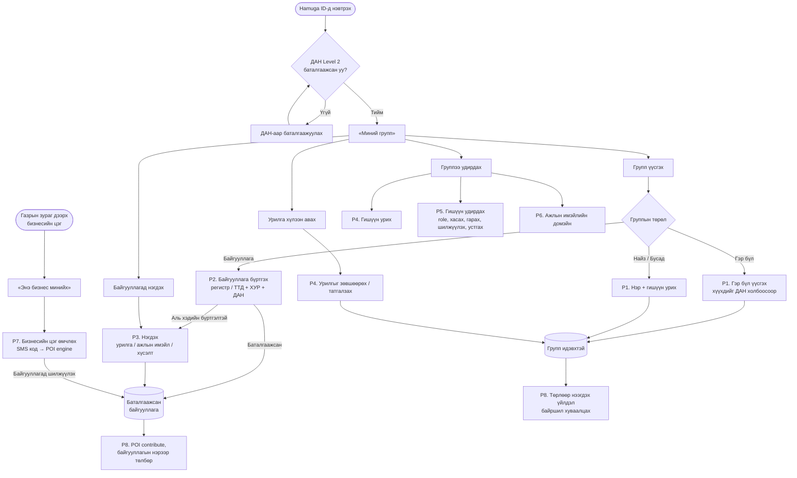

| Процесс | Story | Гол дүрэм |
|---|---|---|
| P1. Групп үүсгэх | NAV-024 | Төрөл үүсгэсний дараа солигдохгүй; үүсгэгч = Эзэмшигч |
| P2. Байгууллага бүртгэх, баталгаажуулах | NAV-029 | Бүх төрлийн байгууллагад **нэг процесс**: регистр/ТТД → хариуцах иргэн (ХУР) → шууд эсвэл удирдлагын ДАН зөвшөөрөл (72 цаг) |
| P3. Байгууллагад нэгдэх | NAV-028 | 3 зам: урилга, ажлын имэйлийн OTP, нэгдэх хүсэлт. Админ руу код илгээхгүй |
| P4. Урих, хүлээн авах | NAV-026, NAV-025 | Утас/имэйлээр; Hamuga ID-гүй бол бүртгүүлэх холбоос; 7 хоног хүчинтэй |
| P5. Гишүүн удирдах | NAV-026, NAV-027 | Эрхийн матриц; Админ зөвхөн «Гишүүн»-ийг хасна |
| P6. Домэйн тохируулах | NAV-028 E | Эзэмшигч тэр домэйны имэйлийн OTP-оор нотолно; нийтийн домэйн хориотой |
| P7. Бизнесийн цэг өмчлөх | NAV-032 | Регистргүй бизнест; ДАН Level 2 + бизнесийн утасны SMS код |
| P8. Төрлөөр нээгдэх үйлдэл | NAV-030, NAV-031 | Төлбөр зөвхөн баталгаажсан байгууллагад |

---

## 2. P1 — Гэр бүл, Найз, Бусад групп үүсгэх (NAV-024)

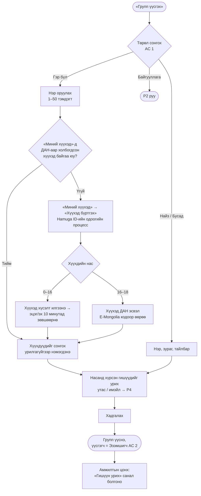

- Хүүхэд урилга зөвшөөрөх шаардлагагүй: эцэг/эх ба хүүхдийн холбоо ДАН-аар аль хэдийн баталгаажсан (судалгаа §3.3).
- Хүүхэд 18 нас хүрэхэд группт **насанд хүрсэн гишүүн** болж үлдэнэ. Эцэг/эхийн хяналт (байршил гэх мэт) дахин зөвшөөрөл шаардана.
- Группын дээд хязгаар: нэг хэрэглэгч 20 групп; гишүүд Гэр бүл 20, Найз 50, Бусад 100 (NAV-027).

---

## 3. P2 — Байгууллага бүртгэх ба баталгаажуулах (NAV-029)

### 3.1 Хэрэглэгчийн урсгал

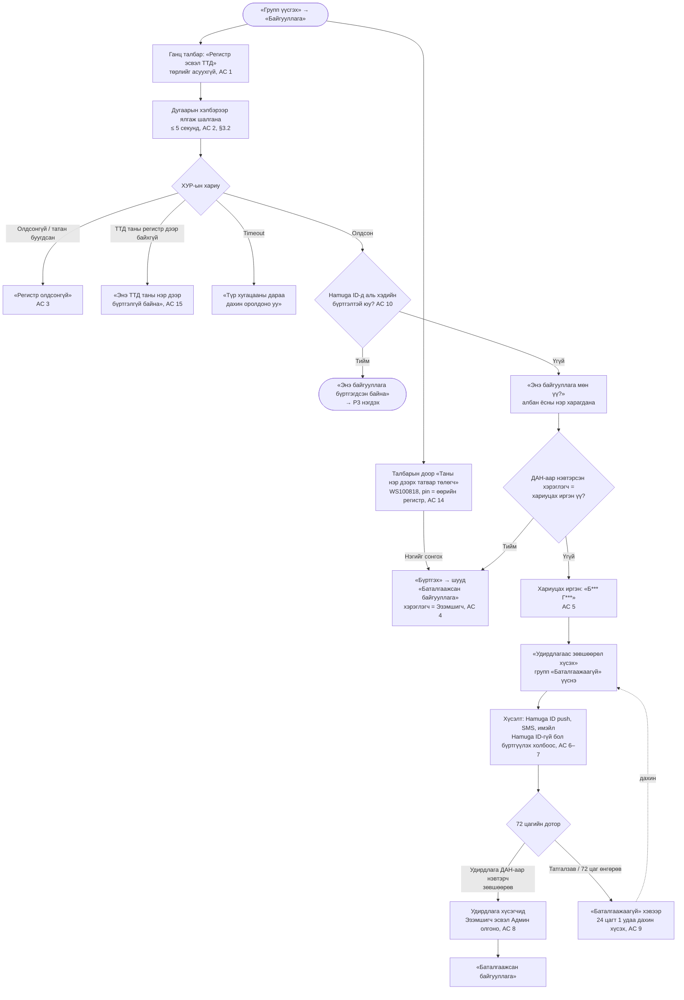

### 3.2 Регистр, ТТД-ийг ХУР-аас хэрхэн шалгах вэ (системийн дараалал)

**ДАН ба ХУР:** ДАН нь хэрэглэгчийг таньж, нэвтэрсэн иргэний регистрийг өгнө. Байгууллагын мэдээлэл ХУР-ын (`xyp.gov.mn`) сервисүүдээс ирнэ.

**`WS100818_taxPayerInfo`-ийн гэрээ (Татварын ерөнхий газар, v1.5.0, ICT Group 2026-10-27):**

| | Талбар | Тайлбар | Төрөл |
|---|---|---|---|
| Оролт | `pin` | Татвар төлөгчийн регистрийн дугаар | String |
| Оролт | `tin` | Татвар төлөгчийн дугаар (ТТД) | String |
| Гаралт | `listTins[]` | Татвар төлөгчийн **жагсаалт** | List |
| Гаралт | `listTins[].tin` | ТТД | String |
| Гаралт | `listTins[].name` | Татвар төлөгчийн нэр | String |

Үүнээс гарах дүгнэлт:
- Нэг регистрт **хэд хэдэн** татвар төлөгч байж болох тул оруулсан ТТД-г жагсаалтын **аль нэг**-тэй тулгана.
- `name` буцаадаг тул хувиараа бизнес эрхлэгчийн «Энэ байгууллага мөн үү?» дэлгэцэд нэрийг харуулж болно.
- Гаралтад **удирдлага, төрөл, төлөв байхгүй**. Хуулийн этгээдийн удирдлагыг тодорхойлоход хуулийн этгээдийн сервис (Б1) хэрэгтэй хэвээр. Хувиараа бизнес эрхлэгч идэвхтэй эсэхийг энэ сервисээр мэдэхгүй (Б6).

**Дугаарыг хэлбэрээр нь ялгана** (дараалан оролдохгүй; хэрэглэгчээс төрлийг асуухгүй):

| Оруулсан утга | Гэж үзэх | Дуудах сервис | Тулгалт |
|---|---|---|---|
| 7 орон | Хуулийн этгээдийн регистр (хуулийн этгээдийн ТТД = регистр гэж үзнэ, Б2) | ХУР: хуулийн этгээдийн мэдээлэл | Удирдлагын регистр = нэвтэрсэн иргэний регистр → шууд; үгүй бол удирдлагын зөвшөөрөл |
| Бусад урттай тоо | Иргэний ТТД (хувиараа бизнес эрхлэгч) | `WS100818_taxPayerInfo`, `pin` = **нэвтэрсэн иргэний** регистр | Оруулсан утга ∈ `listTins[].tin` → шууд; үгүй бол «таны нэр дээр бүртгэлгүй» |
| 2 үсэг + 8 орон | Иргэний регистр | `WS100818_taxPayerInfo`, `pin` = оруулсан утга, **зөвхөн** нэвтэрсэн иргэнийх бол | Өөр хүний регистр бол «Өөрийн регистр эсвэл байгууллагын регистрийг оруулна уу» |

> **Хувийн мэдээллийн дүрэм (AC 16):** `WS100818_taxPayerInfo`-ийн `pin`-д зөвхөн ДАН-аар нэвтэрсэн хэрэглэгчийн **өөрийн** регистрийг дамжуулна. Хэрэглэгчийн бичсэн өөр хүний регистрээр ТТД, нэр лавлахгүй.

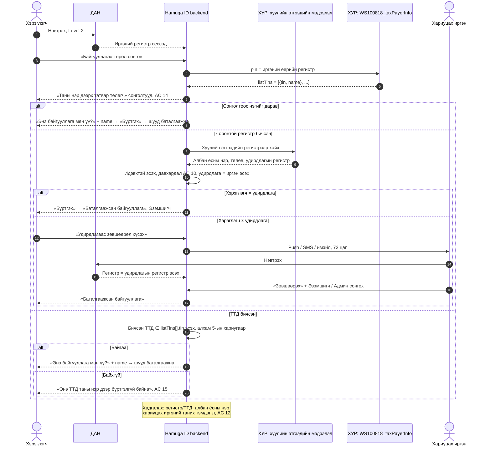

| Байгууллагын төрөл | Оруулах дугаар | Хариуцах иргэн | ХУР-ын сервис | Тулгалт |
|---|---|---|---|---|
| ХХК, ХК, ТББ, сан, холбоо, төрийн байгууллага | Хуулийн этгээдийн регистр (7 орон) | Гүйцэтгэх удирдлага | Хуулийн этгээдийн мэдээлэл | Удирдлагын регистр = нэвтэрсэн иргэний регистр |
| Хувиараа бизнес эрхлэгч | ТТД, эсвэл жагсаалтаас сонгоно | Иргэн өөрөө | `WS100818_taxPayerInfo` | Оруулсан ТТД ∈ иргэний `listTins` |
| Гадаадын байгууллагын салбар | Хуулийн этгээдийн регистр | Монгол дахь удирдлага | Хуулийн этгээдийн мэдээлэл | Удирдлага ДАН-гүй бол баталгаажихгүй (R3, хүлээн зөвшөөрсөн) |
| Регистргүй бизнес (ТҮЦ, зах, гэрийн үйлдвэрлэл) | — | — | — | P2 биш, **P7**-оор цэгээ өмчилнө |

Хувиараа бизнес эрхлэгчид «Удирдлагаас зөвшөөрөл хүсэх» зам **байхгүй**: татвар төлөгч нь иргэн өөрөө тул ТТД таны регистр дээр байхгүй бол өөр хэн нэгнээс зөвшөөрөл авах шаардлагагүй.

### 3.3 Баталгаажсаны дараах хяналт

- **Сар бүрийн тулгалт (AC 13):** ХУР-аас хуулийн этгээдийн мэдээллийг дахин татаж удирдлага солигдсон эсэхийг шалгана. Солигдсон бол хуучин удирдлагаар баталгаажсан Эзэмшигчийн эрх «Хүлээгдэж буй» болж, шинэ удирдлага руу зөвшөөрлийн хүсэлт автоматаар очно.
- Олон хариуцах иргэнтэй бол аль нэг нь зөвшөөрөхөд хангалттай.
- Хассан аргууд: видео, баримт бичиг, операторын хяналт, тоон гарын үсэг, данснаас шилжүүлэг (P5).

---

## 4. P3 — Байгууллагад нэгдэх (NAV-028)

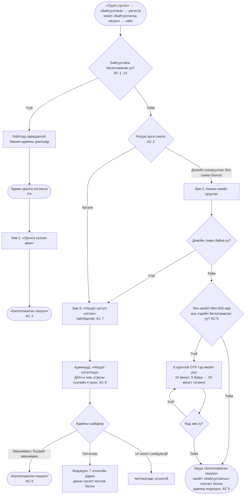

- Админ руу код илгээх, кодыг гараар дамжуулах механизм **байхгүй** (AC 16).
- «Баталгаажсан гишүүн» болох хүртэл байгууллагын POI засах, төлбөр төлөх боломжгүй (AC 14).

---

## 5. P4 — Гишүүн урих ба урилга хүлээн авах (NAV-026, NAV-025)

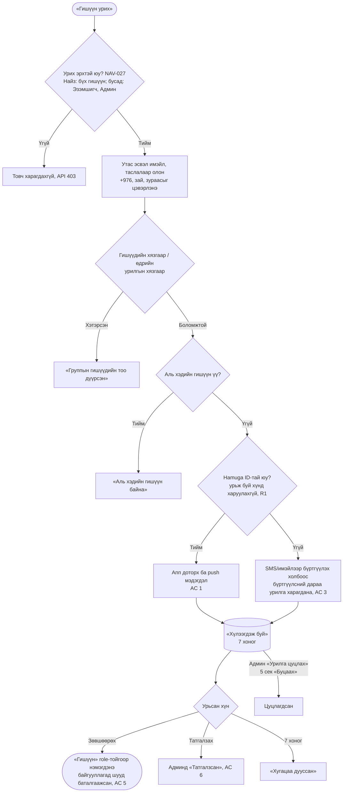

- Байгууллагын группт урилгыг хэрэглэгчийн баталгаажсан **байгууллагын** контактаар (NAV-025) ч хайна. Баталгаажаагүй контактаар урилга хүлээн авах боломжгүй.
- Ижил хүн рүү давхар урилга илгээхгүй, хуучныг шинэчилнэ.

---

## 6. P5 — Гишүүн удирдах (NAV-026, NAV-027)

```mermaid
flowchart TD
    S(["Гишүүний мөрийн «⋯» цэс эсвэл<br/>«Группын тохиргоо»"]) --> ACT{"Үйлдэл"}

    ACT -- "Role солих" --> RC{"Эзэмшигч мөн үү?"}
    RC -- "Тийм" --> RC1["Админ ↔ Гишүүн<br/>шууд, мэдэгдэл очно, AC 2"]
    RC -- "Үгүй" --> X["Цэсэнд харагдахгүй, API 403"]

    ACT -- "Группээс хасах" --> RM{"Хэн хэнийг?"}
    RM -- "Эзэмшигч → хэн ч" --> RM1["Зөвшөөрлийн цонх"]
    RM -- "Админ → «Гишүүн»<br/>Найз төрлөөс бусад" --> RM1
    RM -- "Админ → Эзэмшигч / Админ<br/>Гишүүн → хэн ч" --> X
    RM1 --> RM2["Хасагдана; тэр группын байршил<br/>хуваалцалт шууд зогсоно, NAV-030<br/>хүүхэд бол «Миний хүүхэд» холбоос хэвээр"]

    ACT -- "Группээс гарах" --> LV{"Эзэмшигч мөн үү?"}
    LV -- "Үгүй" --> LV1["Зөвшөөрлийн цонх → гарна, AC 8"]
    LV -- "Тийм, өөр гишүүнтэй" --> TR["Эхлээд «Эзэмшлийг шилжүүлэх», AC 9"]
    LV -- "Тийм, ганцаараа" --> DEL

    ACT -- "Эзэмшлийг шилжүүлэх" --> TR
    TR --> TR1["Насанд хүрсэн гишүүнээс шинэ Эзэмшигч<br/>сонгох → хуучин Эзэмшигч Админ болно"]

    ACT -- "Групп устгах<br/>«Аюултай бүс»" --> DEL["Зөвшөөрлийн цонх → бүх гишүүнд<br/>мэдэгдэл, буцаах боломжгүй"]
```

| Үйлдэл | Гэр бүл | Байгууллага | Найз | Бусад |
|---|---|---|---|---|
| Гишүүн урих | Эзэмшигч, Админ | Эзэмшигч, Админ | Бүх гишүүн | Эзэмшигч, Админ |
| Гишүүн хасах | Эзэмшигч, Админ¹ | Эзэмшигч, Админ¹ | Эзэмшигч | Эзэмшигч, Админ¹ |
| Role өөрчлөх | Эзэмшигч | Эзэмшигч | Эзэмшигч | Эзэмшигч |
| Группын мэдээлэл засах | Эзэмшигч, Админ | Эзэмшигч, Админ | Эзэмшигч | Эзэмшигч, Админ |

¹ Админ зөвхөн «Гишүүн»-ийг хасна (PO баталсан 2026-10-26). Бүх role өөрчлөлт, хасалт аудитын логт бичигдэнэ.

---

## 7. P6 — Ажлын имэйлийн домэйн тохируулах (NAV-028 E)

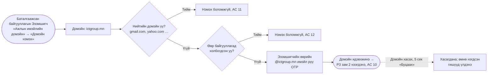

---

## 8. P7 — Бизнесийн цэг өмчлөх (NAV-032)

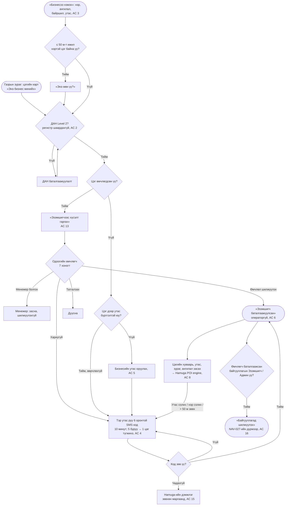

- Нэг хэрэглэгч ≤ 10 цэг; илүү бол «Байгууллага» групп үүсгэхийг санал болгоно (AC 12). Өдөрт ≤ 3 өмчлөх хүсэлт (AC 19).
- Хувь хүний цэг байгууллагын нэрээр төлбөр төлөхгүй (AC 17).

---

## 9. P8 — Группын төрлөөр нээгдэх үйлдэл (NAV-030, NAV-031)

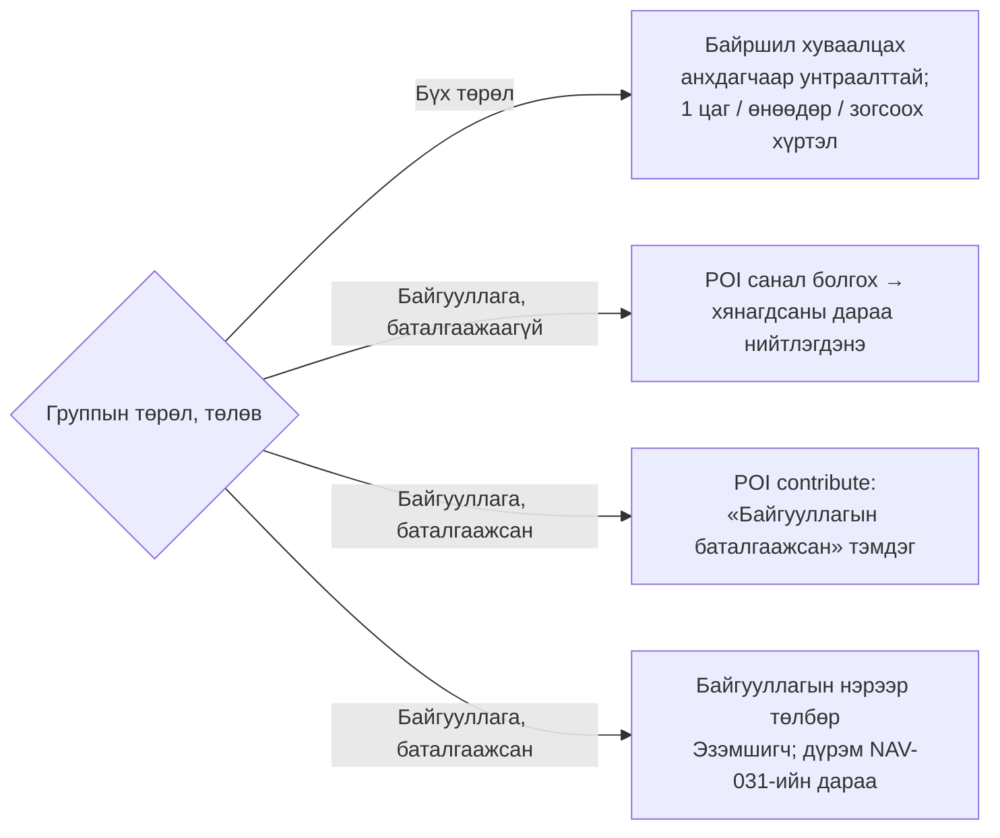

Төрөлд хамааралгүй үйлдэл UI дээр **нуугдана** (идэвхгүй биш). Төрөл бүрт аль үйлдэл нээлттэй байхыг feature flag-аар удирдана.

---

## 10. Төлвийн диаграм

### 10.1 Байгууллагын группын төлөв

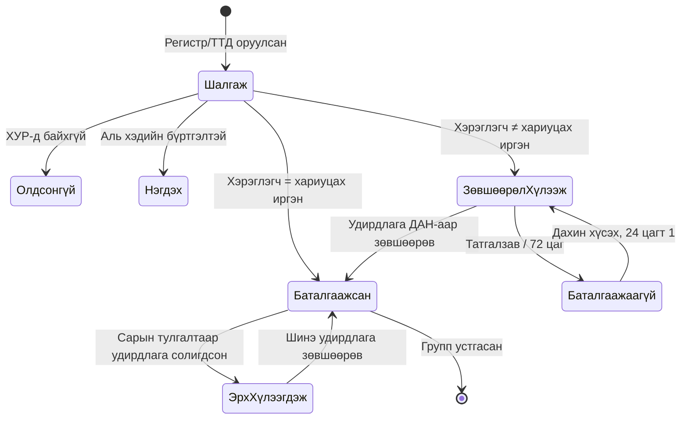

### 10.2 Гишүүнчлэлийн төлөв

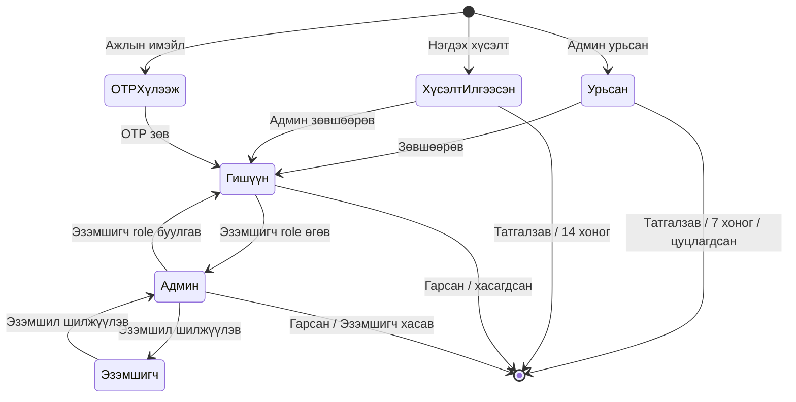

---

## 11. Хугацаа ба хязгаарын нэгдсэн жагсаалт

| Хаана | Утга | Story |
|---|---|---|
| Регистр шалгах хариу | ≤ 5 секунд | NAV-029 AC 2 |
| Удирдлагын зөвшөөрөл | 72 цаг; дахин хүсэх 24 цагт 1 | NAV-029 AC 8–9 |
| Хүүхдийн (0–16) баталгаажуулалт | 10 минут | Hamuga ID kids-guide |
| Ажлын имэйлийн OTP | 10 минут; 5 буруу → 15 минут түгжинэ | NAV-028 AC 4 |
| Бизнесийн утасны SMS код | 10 минут; 5 буруу → 1 цаг; цагт ≤ 3 илгээх | NAV-032 AC 4 |
| Урилга | 7 хоног | NAV-026 AC 4 |
| Нэгдэх хүсэлт | 14 хоногт автоматаар хүчингүй; татгалзсаны дараа 7 хоног | NAV-028 AC 9 |
| POI маргаан | 7 хоног | NAV-032 AC 15 |
| «Буцаах» (undo) | 5 секунд | Прототип |
| Удирдлагын тулгалт | Сар бүр | NAV-029 AC 13 |

## 12. Нээлттэй асуудлууд

| # | Асуудал | Хариуцагч |
|---|---|---|
| Б1 | ХУР-ын хуулийн этгээдийн сервисийн нэр, гүйцэтгэх удирдлагын регистрийг буцаадаг эсэхийг техникийн түвшинд баталгаажуулах | architect, ICT Group |
| Б2 | ~~Дугаарыг шалгах дараалал~~ → **хэлбэрээр ялгана** (§3.2); `WS100818`-ийн гэрээ ирсэн (2026-10-27). Үлдсэн: хуулийн этгээдийн ТТД нь 7 оронтой регистртэйгээ ижил, иргэний ТТД 7 оронтой биш гэдгийг баталгаажуулах | architect |
| Б3 | Суурин утастай бизнест SMS биш дуут код хэрэгтэй эсэх | PO (NAV-032) |
| Б4 | Бүртгэлгүй хүүхдэд эцэг/эх Hamuga ID үүсгэх урсгал | ICT Group (судалгаа §3.3) |
| Б5 | Админы мэдэгдлийн digest, хүсэгчийн бүтэн нэрийг харуулах эсэх | PO (NAV-028) |
| Б6 | `WS100818_taxPayerInfo` татвар төлөгчийн төлөв (идэвхтэй / хаагдсан) буцаахгүй. Үйл ажиллагаагаа зогсоосон хувиараа бизнес эрхлэгчийг яаж ялгах вэ? | architect, PO |
| Б7 | `WS100818`-д `pin` болон `tin`-ийг хамт өгвөл шүүлт хийдэг эсэх, олдохгүй үед хоосон жагсаалт эсвэл алдаа буцаахыг турших | architect |
