# Процессын зураглал — «Групп, байгууллагын бүртгэл» эпик

> Огноо: 2026-10-27, шинэчилсэн 2026-11-02 · Хариуцагч: business-analyst · Төлөв: draft (D38: Hamuga-тай бичгээр тохиролцох хүртэл)
> Эх сурвалж: NAV-024 … NAV-035, [ADR-0020 + A1](../architecture/adr/0020-hamuga-id-vs-apps-group-responsibilities-mn.md), [судалгаа](../architecture/spikes/group-org-sso-research-mn.md), [прототип](../design/prototypes/NAV-024-groups.html)
> Зорилго: эпикийн **бүх үйлдлийг** нэг дор, хэн (оролцогч) ямар системтэй (ДАН, POI engine гэх мэт) харилцаж байгааг харуулах. AC-ийн дугаар бүр тухайн story-д заагдсан.

## 0. Оролцогчид ба системүүд

| Оролцогч / систем | Үүрэг |
|---|---|
| **Хэрэглэгч** | Hamuga ID-аар нэвтэрсэн, ДАН Level 2 баталгаажсан иргэн |
| **Эзэмшигч / Админ / Гишүүн** | Группын role (NAV-027) |
| **Хариуцах иргэн** | Байгууллагын регистрт бүртгэлтэй гүйцэтгэх удирдлага, эсвэл хувиараа бизнес эрхлэгч өөрөө (NAV-029) |
| **Ажилтан** | Байгууллагад нэгдэх гэж буй хэрэглэгч (NAV-028) |
| **Hamuga ID** | Байгууллага, гэр бүл, эцэг/эх–хүүхдийн холбоо, тэдгээрийн гишүүнчлэл, эрх, аудитын лог, мэдэгдэл (push, SMS, имэйл); апп-уудад NAV-035-ын API, webhook |
| **iMap** («Групп» цэс) | «Групп» (найз, баг, клуб: нэг төрөл), холбоос/QR урилга, **бүх группт** байршил хуваалцах, хүүхдийн горим. Гэр бүлийг ID-аас уншина |
| **ДАН** | Иргэнийг таних (нэвтрэх, Level 2), «Миний хүүхэд» холбоос. Нэвтэрсэн иргэний **регистрийг** Hamuga ID-д өгнө |
| **ХУР** (`xyp.gov.mn`, төрийн мэдээлэл солилцоо) | **Хуулийн этгээдийн мэдээлэл** (регистр → нэр, удирдлага, төлөв; сервисийн нэр TBD, Б1). Татварын ерөнхий газрын **`WS100818_taxPayerInfo`** v1.5.0: оролт `pin` (регистр), `tin` (ТТД) → гаралт `listTins[]` = {`tin`, `name`} |
| **Hamuga POI engine** | Газрын зураг дээрх бизнесийн цэг (ADR-0007) |

## 1. Ерөнхий зураглал

Хэрэглэгч группын **төрөл сонгохгүй**: аль цэснээс эхэлж байгаа нь төрлийг тодорхойлно (Hick, Tesler: сонголтыг систем хариуцна).

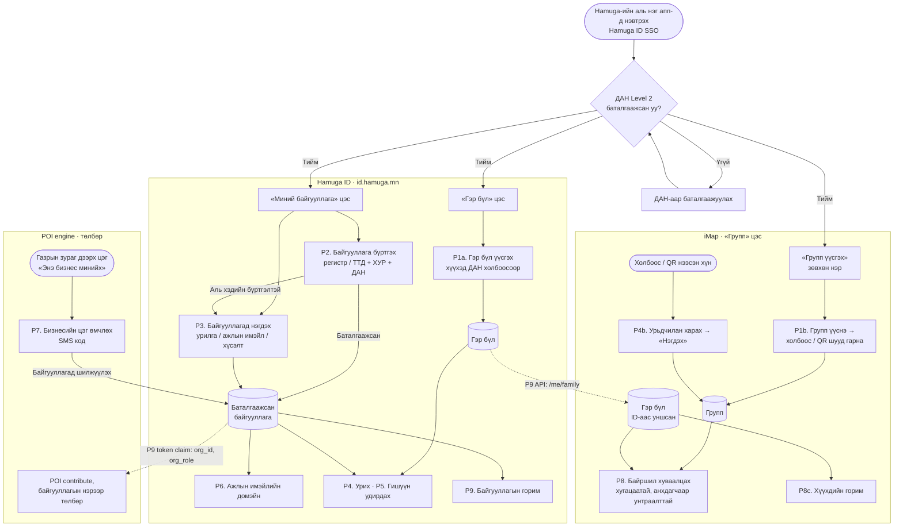

**Систем ([ADR-0020 + A1](../architecture/adr/0020-hamuga-id-vs-apps-group-responsibilities-mn.md)):** ID нь «хэн бэ, хэнийг төлөөлдөг вэ, хэн хэний гэр бүл вэ»-г, апп нь «юу хийх вэ»-г хариуцна. Тасархай шугам нь системийн хоорондох гэрээ (P9).

| Процесс | Систем | Story | Гол дүрэм |
|---|---|---|---|
| P1a. Гэр бүл үүсгэх | **ID** | NAV-024 B | Нэр л асууна; «Миний хүүхэд»-ийн хүүхдүүд урилгагүй нэмэгдэнэ; үүсгэгч = Эзэмшигч |
| P1b. Групп үүсгэх | **iMap** | NAV-033 A | **Төрөл асуухгүй**, зөвхөн нэр; үүсмэгц холбоос/QR-тай «Гишүүн нэмэх» цонх |
| P2. Байгууллага бүртгэх, баталгаажуулах | **ID** | NAV-029 | Бүх төрлийн байгууллагад **нэг процесс**: регистр/ТТД → хариуцах иргэн (ХУР) → шууд эсвэл удирдлагын ДАН зөвшөөрөл (72 цаг) |
| P3. Байгууллагад нэгдэх | **ID** | NAV-028 | 3 зам: урилга, ажлын имэйлийн OTP, нэгдэх хүсэлт. Админ руу код илгээхгүй |
| P4a. Утас/имэйлээр урих | **ID** (байгууллага, гэр бүл); **iMap** (нэмэлт зам) | NAV-026, NAV-025 | Hamuga ID-гүй бол бүртгүүлэх холбоос; 7 хоног хүчинтэй |
| P4b. Холбоос/QR-ээр нэгдэх | **iMap** | NAV-033 AC 3 | Группын нэр, гишүүдийг хараад «Нэгдэх»; холбоос шинэчлэхэд хуучин нь хүчингүй |
| P5. Гишүүн удирдах | **ID** (байгууллага, гэр бүл); **iMap** (групп) | NAV-026, NAV-027; NAV-033 | Эрхийн матриц §6; Админ зөвхөн «Гишүүн»-ийг хасна |
| P6. Домэйн тохируулах | **ID** | NAV-028 E | Эзэмшигч тэр домэйны имэйлийн OTP-оор нотолно; нийтийн домэйн хориотой |
| P7. Бизнесийн цэг өмчлөх | **POI engine** | NAV-032 | Регистргүй бизнест; ДАН Level 2 + бизнесийн утасны SMS код |
| P8. Байршил хуваалцах, хүүхдийн горим | **iMap** | NAV-033 B–D, NAV-034 | Анхдагчаар унтраалттай, хугацаатай; группээр нуух; түүх хадгалахгүй |
| P8d. Байгууллагын үйлдэл | **POI engine**, **төлбөр** | NAV-030 B, C; NAV-031 | Зөвхөн баталгаажсан байгууллагад |
| P9. ID → апп-уудын гэрээ | **ID** | NAV-035 | `org_id`, `org_role` claim; гэр бүл, хүүхдийн жагсаалт; webhook; байгууллагын горим |

---

## 2. P1 — Гэр бүл (Hamuga ID) ба Групп (iMap) үүсгэх

> ADR-0020 A1 (2026-10-28): «Гэр бүл»-ийг Hamuga ID-ийн «Гэр бүл» цэсэнд үүсгэж удирдана. Найз, баг, клубыг iMap-ын «Групп» цэсэнд **нэг төрлөөр** үүсгэнэ (PO 2026-10-28: «ижил төрлийн групп учраас сонгуулах шаардлагагүй»). iMap гэр бүлийг NAV-035-аар уншиж, байршил хуваалцана.

### 2.1 P1a — Гэр бүл үүсгэх (Hamuga ID, NAV-024 B)

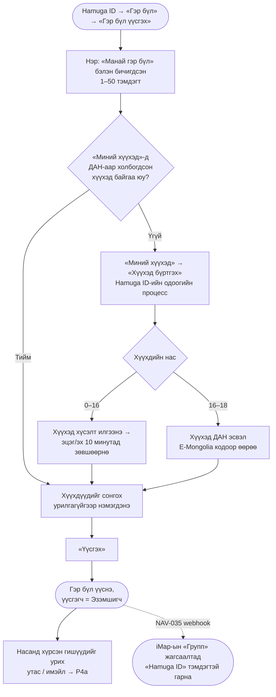

- Хүүхэд урилга зөвшөөрөх шаардлагагүй: эцэг/эх ба хүүхдийн холбоо ДАН-аар аль хэдийн баталгаажсан (судалгаа §3.3).
- Хүүхэд 18 нас хүрэхэд группт **насанд хүрсэн гишүүн** болж үлдэнэ. Эцэг/эхийн хяналт (байршил гэх мэт) дахин зөвшөөрөл шаардана.
- Гэр бүлийн гишүүнийг iMap-аас урих, хасах **боломжгүй**: iMap «Hamuga ID-д удирдах» холбоосоор ID-ийн тэр группыг нээнэ.

### 2.2 P1b — Групп үүсгэх (iMap, NAV-033 A)

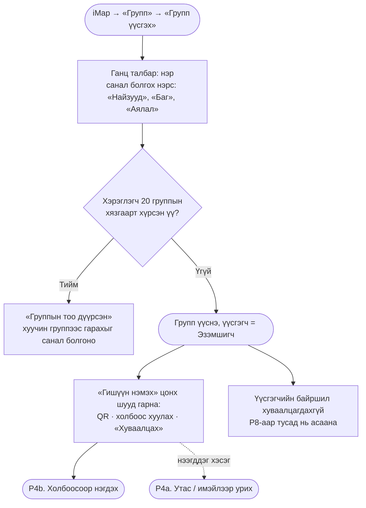

- Төрлийн алхам байхгүй тул 3 алхам → 1 алхам (Hick, Occam). Зураг, тайлбарыг дараа нь тохиргооноос нэмнэ.
- Хязгаар: нэг хэрэглэгч 20 групп; гэр бүл 20 гишүүн; **«Групп» гишүүний хязгаар Б8** (найз 50 / бусад 100 нэгдсэн тул PO шийднэ).

---

## 3. P2 — Байгууллага бүртгэх ба баталгаажуулах (NAV-024, NAV-029, Hamuga ID)

### 3.1 Хэрэглэгчийн урсгал

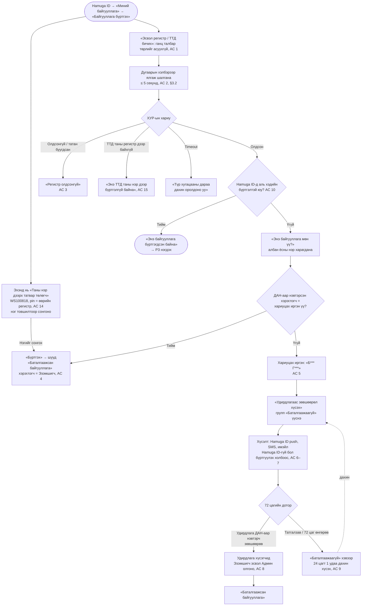

### 3.2 Регистр, ТТД-ийг ХУР-аас хэрхэн шалгах вэ (системийн дараалал)

**ДАН ба ХУР:** ДАН нь хэрэглэгчийг таньж, нэвтэрсэн иргэний регистрийг өгнө. Байгууллагын мэдээлэл ХУР-ын (`xyp.gov.mn`) сервисүүдээс ирнэ.

**`WS100818_taxPayerInfo`-ийн гэрээ (Татварын ерөнхий газар, v1.5.0, ICT Group 2026-10-27):**

| | Талбар | Тайлбар | Төрөл |
|---|---|---|---|
| Оролт | `pin` | Татвар төлөгчийн регистрийн дугаар | String |
| Оролт | `tin` | Татвар төлөгчийн дугаар (ТТД) | String |
| Гаралт | `listTins[]` | Татвар төлөгчийн **жагсаалт** | List |
| Гаралт | `listTins[].tin` | ТТД | String |
| Гаралт | `listTins[].name` | Татвар төлөгчийн нэр | String |

Үүнээс гарах дүгнэлт:
- Нэг регистрт **хэд хэдэн** татвар төлөгч байж болох тул оруулсан ТТД-г жагсаалтын **аль нэг**-тэй тулгана.
- `name` буцаадаг тул хувиараа бизнес эрхлэгчийн «Энэ байгууллага мөн үү?» дэлгэцэд нэрийг харуулж болно.
- Гаралтад **удирдлага, төрөл, төлөв байхгүй**. Хуулийн этгээдийн удирдлагыг тодорхойлоход хуулийн этгээдийн сервис (Б1) хэрэгтэй хэвээр. Хувиараа бизнес эрхлэгч идэвхтэй эсэхийг энэ сервисээр мэдэхгүй (Б6).

**Дугаарыг хэлбэрээр нь ялгана** (дараалан оролдохгүй; хэрэглэгчээс төрлийг асуухгүй):

| Оруулсан утга | Гэж үзэх | Дуудах сервис | Тулгалт |
|---|---|---|---|
| 7 орон | Хуулийн этгээдийн регистр (хуулийн этгээдийн ТТД = регистр гэж үзнэ, Б2) | ХУР: хуулийн этгээдийн мэдээлэл | Удирдлагын регистр = нэвтэрсэн иргэний регистр → шууд; үгүй бол удирдлагын зөвшөөрөл |
| Бусад урттай тоо | Иргэний ТТД (хувиараа бизнес эрхлэгч) | `WS100818_taxPayerInfo`, `pin` = **нэвтэрсэн иргэний** регистр | Оруулсан утга ∈ `listTins[].tin` → шууд; үгүй бол «таны нэр дээр бүртгэлгүй» |
| 2 үсэг + 8 орон | Иргэний регистр | `WS100818_taxPayerInfo`, `pin` = оруулсан утга, **зөвхөн** нэвтэрсэн иргэнийх бол | Өөр хүний регистр бол «Өөрийн регистр эсвэл байгууллагын регистрийг оруулна уу» |

> **Хувийн мэдээллийн дүрэм (AC 16):** `WS100818_taxPayerInfo`-ийн `pin`-д зөвхөн ДАН-аар нэвтэрсэн хэрэглэгчийн **өөрийн** регистрийг дамжуулна. Хэрэглэгчийн бичсэн өөр хүний регистрээр ТТД, нэр лавлахгүй.

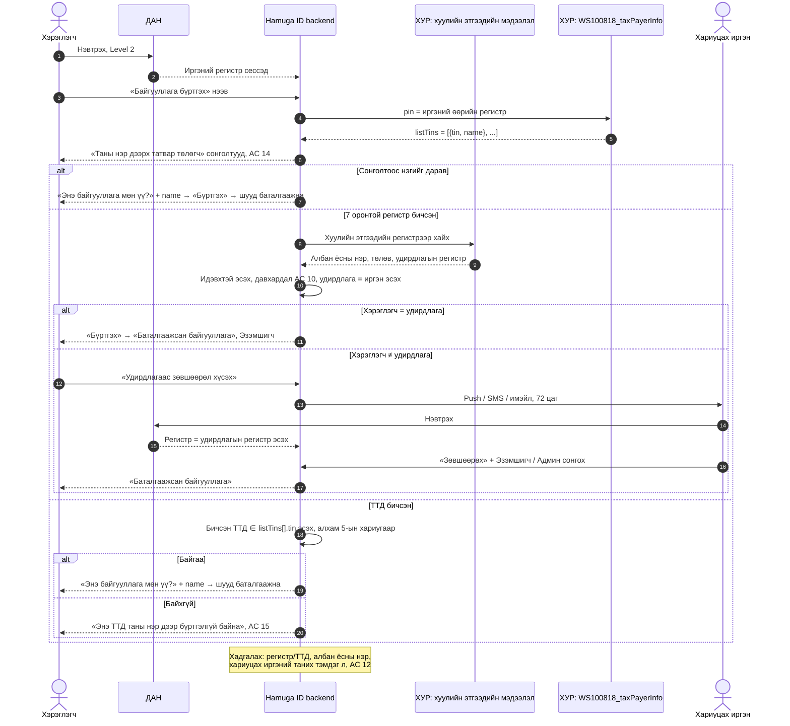

| Байгууллагын төрөл | Оруулах дугаар | Хариуцах иргэн | ХУР-ын сервис | Тулгалт |
|---|---|---|---|---|
| ХХК, ХК, ТББ, сан, холбоо, төрийн байгууллага | Хуулийн этгээдийн регистр (7 орон) | Гүйцэтгэх удирдлага | Хуулийн этгээдийн мэдээлэл | Удирдлагын регистр = нэвтэрсэн иргэний регистр |
| Хувиараа бизнес эрхлэгч | ТТД, эсвэл жагсаалтаас сонгоно | Иргэн өөрөө | `WS100818_taxPayerInfo` | Оруулсан ТТД ∈ иргэний `listTins` |
| Гадаадын байгууллагын салбар | Хуулийн этгээдийн регистр | Монгол дахь удирдлага | Хуулийн этгээдийн мэдээлэл | Удирдлага ДАН-гүй бол баталгаажихгүй (R3, хүлээн зөвшөөрсөн) |
| Регистргүй бизнес (ТҮЦ, зах, гэрийн үйлдвэрлэл) | — | — | — | P2 биш, **P7**-оор цэгээ өмчилнө |

Хувиараа бизнес эрхлэгчид «Удирдлагаас зөвшөөрөл хүсэх» зам **байхгүй**: татвар төлөгч нь иргэн өөрөө тул ТТД таны регистр дээр байхгүй бол өөр хэн нэгнээс зөвшөөрөл авах шаардлагагүй.

### 3.3 Баталгаажсаны дараах хяналт

- **Сар бүрийн тулгалт (AC 13):** ХУР-аас хуулийн этгээдийн мэдээллийг дахин татаж удирдлага солигдсон эсэхийг шалгана. Солигдсон бол хуучин удирдлагаар баталгаажсан Эзэмшигчийн эрх «Хүлээгдэж буй» болж, шинэ удирдлага руу зөвшөөрлийн хүсэлт автоматаар очно.
- Олон хариуцах иргэнтэй бол аль нэг нь зөвшөөрөхөд хангалттай.
- Хассан аргууд: видео, баримт бичиг, операторын хяналт, тоон гарын үсэг, данснаас шилжүүлэг (P5).

---

## 4. P3 — Байгууллагад нэгдэх (NAV-028)

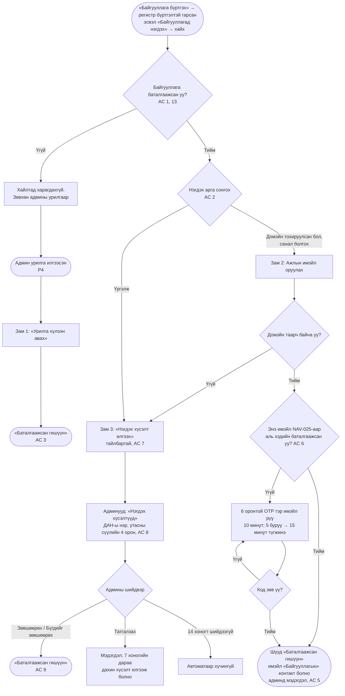

- Админ руу код илгээх, кодыг гараар дамжуулах механизм **байхгүй** (AC 16).
- «Баталгаажсан гишүүн» болох хүртэл байгууллагын POI засах, төлбөр төлөх боломжгүй (AC 14).

---

## 5. P4 — Гишүүн урих ба нэгдэх

### 5.1 P4a — Утас / имэйлээр урих (Hamuga ID: NAV-026, NAV-025; iMap-д нэмэлт зам)

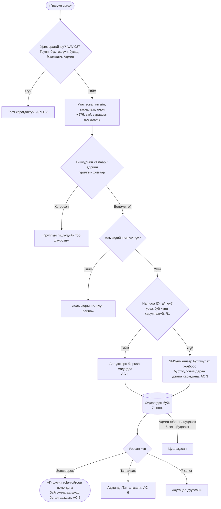

- Байгууллагын группт урилгыг хэрэглэгчийн баталгаажсан **байгууллагын** контактаар (NAV-025) ч хайна. Баталгаажаагүй контактаар урилга хүлээн авах боломжгүй.
- Ижил хүн рүү давхар урилга илгээхгүй, хуучныг шинэчилнэ.

### 5.2 P4b — Холбоос / QR-ээр нэгдэх (iMap, NAV-033 AC 3)

Yandex, 2ГИС-ийн загвар: урьж буй хүн хэний утас, имэйлийг ч мэдэх шаардлагагүй, холбоосоо ямар ч мессенжерээр илгээнэ.

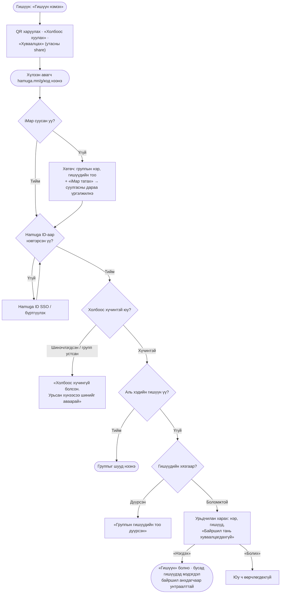

- **Холбоос шинэчлэх** («Холбоос шинэчлэх», 5 сек «Буцаах»): хуучин холбоос шууд хүчингүй болно. Холбоос алдагдсан, буруу хүнд очсон үед ашиглана.
- Холбоосоор нэгдсэн гишүүнийг Эзэмшигч хасаж болно (P5). Урих эрхийг Эзэмшигч тохиргоонд «Зөвхөн Эзэмшигч, Админ» болгож хязгаарлаж болно (Б9).
- Гэр бүл, байгууллагад холбоос/QR урилга **байхгүй**: гэр бүлд хүүхэд ДАН-аар, байгууллагад баталгаажсан зам (P3) ашиглана.

---

## 6. P5 — Гишүүн удирдах (NAV-026, NAV-027)

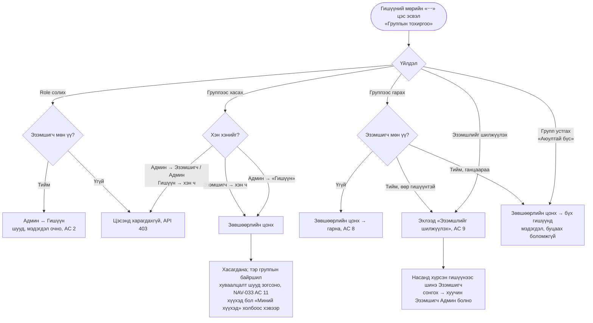

| Үйлдэл | Гэр бүл · ID | Байгууллага · ID | Групп · iMap² |
|---|---|---|---|
| Гишүүн урих / холбоос хуваалцах | Эзэмшигч, Админ | Эзэмшигч, Админ | Бүх гишүүн |
| Холбоос шинэчлэх | — | — | Эзэмшигч, Админ |
| Гишүүн хасах | Эзэмшигч, Админ¹ | Эзэмшигч, Админ¹ | Эзэмшигч, Админ¹ |
| Role өөрчлөх | Эзэмшигч | Эзэмшигч | Эзэмшигч |
| Группын мэдээлэл засах | Эзэмшигч, Админ | Эзэмшигч, Админ | Эзэмшигч, Админ |
| Өөрийн байршлыг хуваалцах, нуух | iMap-д, бүх гишүүн | — | Бүх гишүүн |

¹ Админ зөвхөн «Гишүүн»-ийг хасна (PO баталсан 2026-10-26). Бүх role өөрчлөлт, хасалт аудитын логт бичигдэнэ.
² «Найз», «Бусад» баганыг нэгтгэх санал (NAV-027): урих нь «Найз»-ынх шиг нээлттэй, хасах нь «Бусад»-ынх шиг. PO батлах хүртэл санал.

---

## 7. P6 — Ажлын имэйлийн домэйн тохируулах (NAV-028 E)

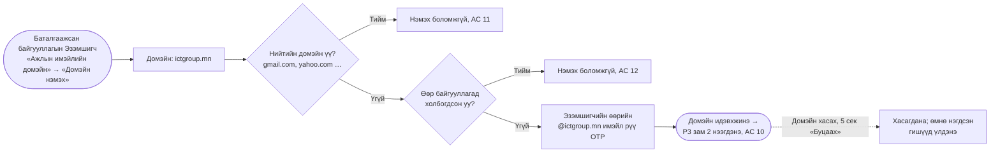

---

## 8. P7 — Бизнесийн цэг өмчлөх (NAV-032, Hamuga POI engine)

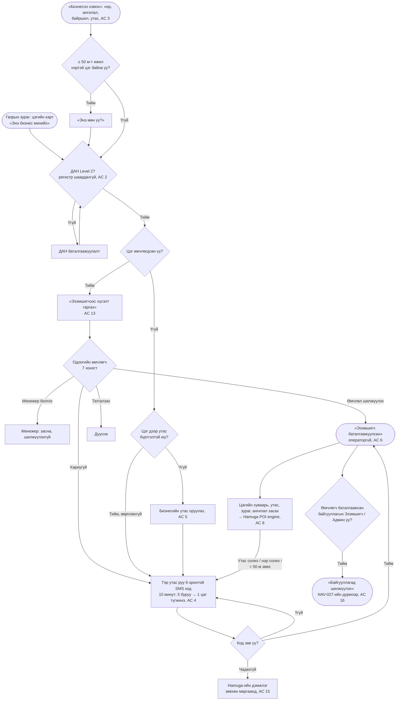

- Нэг хэрэглэгч ≤ 10 цэг; илүү бол «Байгууллага» групп үүсгэхийг санал болгоно (AC 12). Өдөрт ≤ 3 өмчлөх хүсэлт (AC 19).
- Хувь хүний цэг байгууллагын нэрээр төлбөр төлөхгүй (AC 17).

---

## 9. P8 — Байршил хуваалцах ба группын төрлөөр нээгдэх үйлдэл (iMap: NAV-033, NAV-034; POI: NAV-030 B; төлбөр: NAV-030 C, NAV-031)

### 9.1 P8a — Байршил хуваалцах (iMap, NAV-033 B)

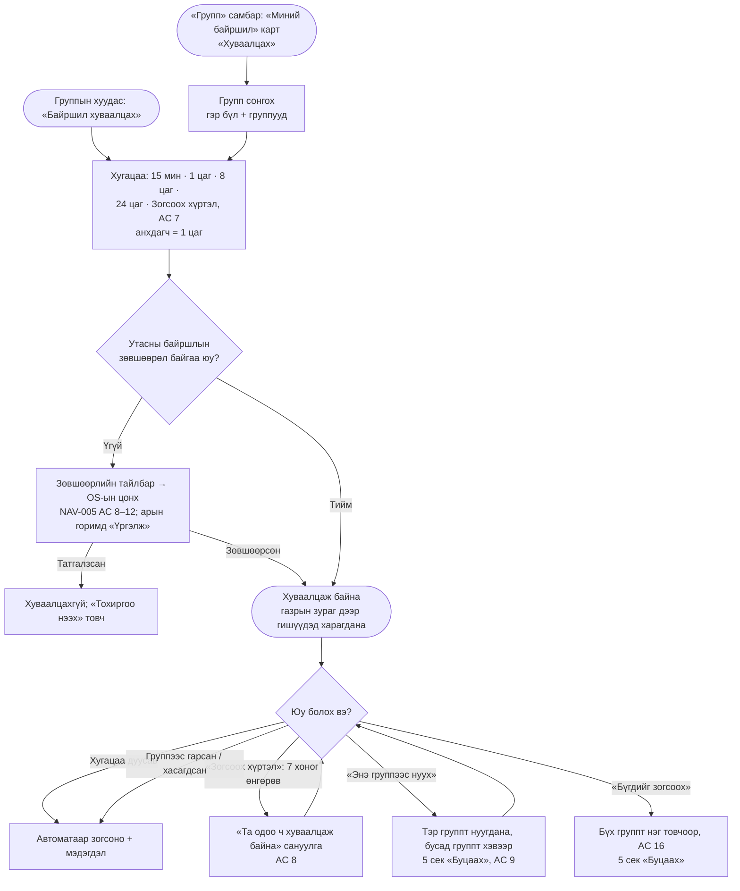

**Газрын зураг дээр харагдах байдал (AC 10):** дусал хэлбэрийн зурагтай цэг. Шинэ байршил (≤ 2 мин) ногоон хүрээтэй, 15 минутаас хуучин бол саарал хүрээтэй «25 мин» гэж харагдана. Гишүүн дээр дарахад газрын зураг тэр хүн рүү очиж, «Зам» товчтой карт гарна. Сүлжээгүй үед сүүлийн байршлыг цагтай нь харуулна.

### 9.2 P8b — Нэг удаагийн байршлын холбоос (iMap, NAV-033 C)

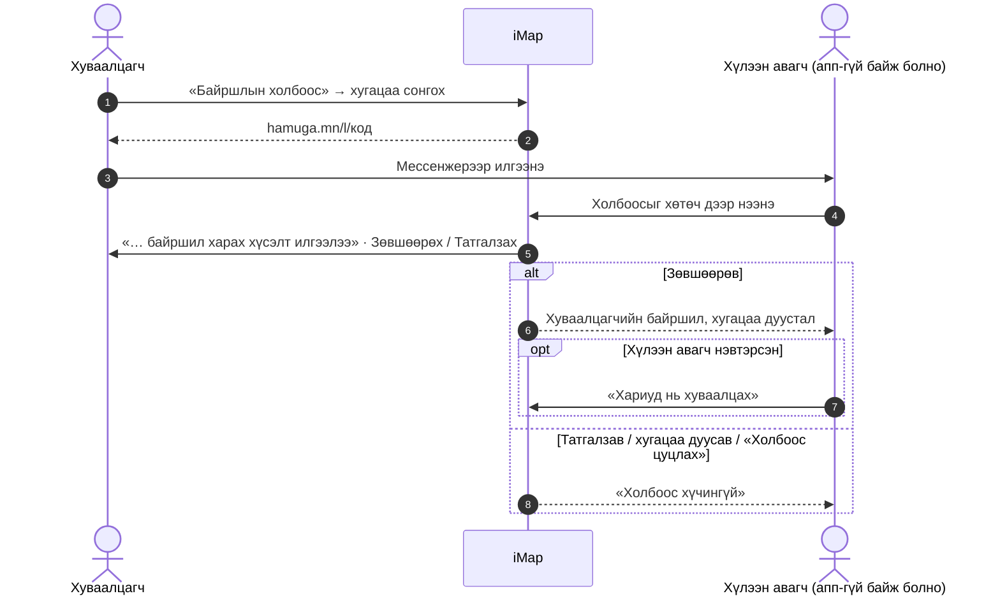

### 9.3 P8c — Хүүхдийн горим (iMap, NAV-034)

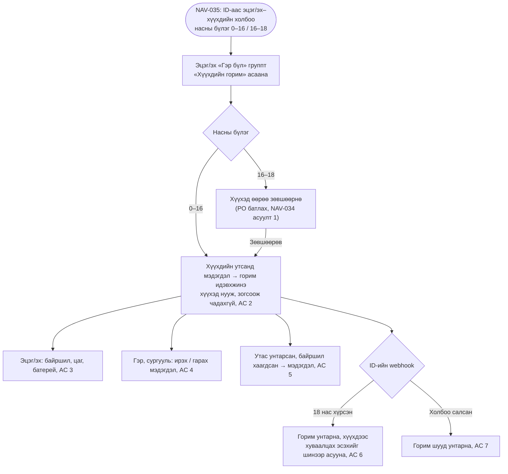

### 9.4 P8d — Байгууллагын үйлдэл (POI engine, төлбөр)

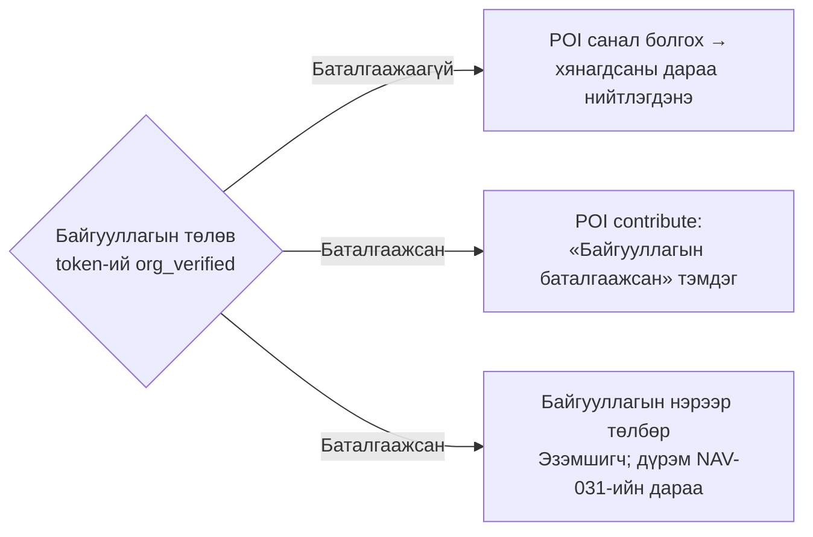

Хамааралгүй үйлдэл UI дээр **нуугдана** (идэвхгүй биш). Аль үйлдэл нээлттэй байхыг feature flag-аар удирдана.

---

## 9b. P9 — Hamuga ID → апп-уудын гэрээ ба байгууллагын горим (NAV-035)

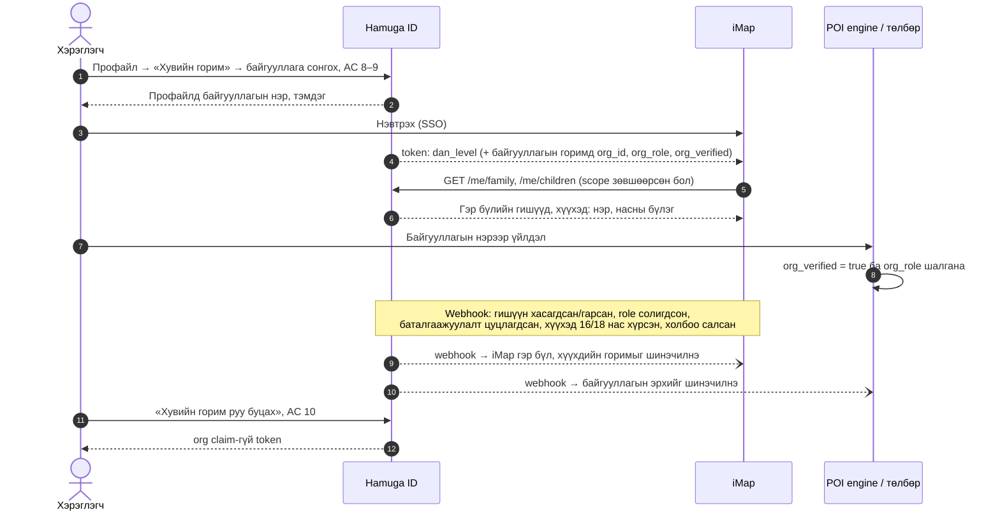

- Байгууллагын горимд байхад байгууллагаас хасагдвал дараагийн token сэргээлтэд хувийн горим руу шилжиж, мэдэгдэл очно.
- Апп бүр хандалтаа `scope`-оор авна. Хүүхдийн мэдээлэл тусдаа `scope`, эцэг/эх тухайн апп-д зөвшөөрнө. Бүх хандалт аудитын логт бичигдэнэ.

---

## 10. Төлвийн диаграм

### 10.1 Байгууллагын группын төлөв

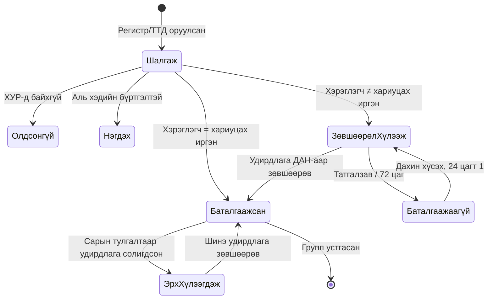

### 10.2 Гишүүнчлэлийн төлөв

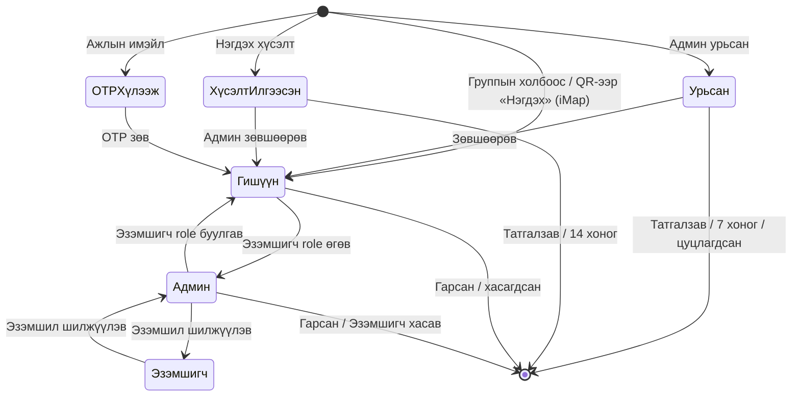

---

### 10.3 Байршил хуваалцалтын төлөв (нэг гишүүн × нэг групп, NAV-033)

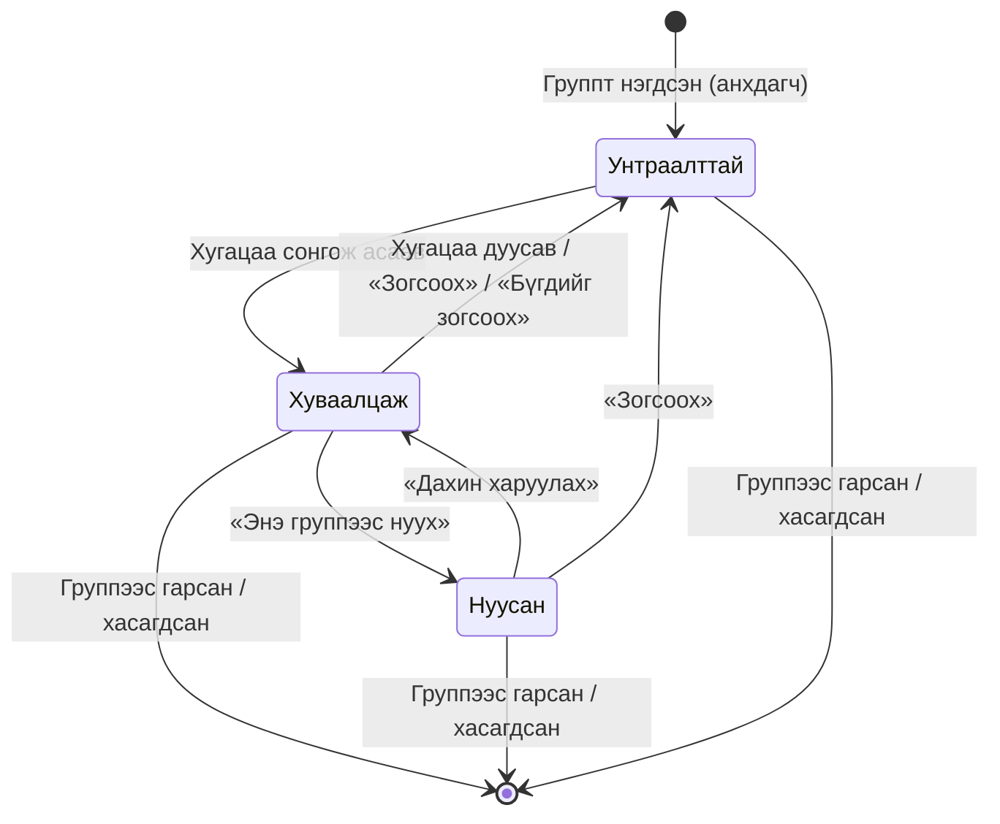

Хүүхдийн горимд (NAV-034) «Нуусан», «Унтраалттай» руу хүүхэд өөрөө шилжүүлж **чадахгүй**.

## 11. Хугацаа ба хязгаарын нэгдсэн жагсаалт

| Хаана | Утга | Story |
|---|---|---|
| Регистр шалгах хариу | ≤ 5 секунд | NAV-029 AC 2 |
| Удирдлагын зөвшөөрөл | 72 цаг; дахин хүсэх 24 цагт 1 | NAV-029 AC 8–9 |
| Хүүхдийн (0–16) баталгаажуулалт | 10 минут | Hamuga ID kids-guide |
| Ажлын имэйлийн OTP | 10 минут; 5 буруу → 15 минут түгжинэ | NAV-028 AC 4 |
| Бизнесийн утасны SMS код | 10 минут; 5 буруу → 1 цаг; цагт ≤ 3 илгээх | NAV-032 AC 4 |
| Урилга | 7 хоног | NAV-026 AC 4 |
| Нэгдэх хүсэлт | 14 хоногт автоматаар хүчингүй; татгалзсаны дараа 7 хоног | NAV-028 AC 9 |
| POI маргаан | 7 хоног | NAV-032 AC 15 |
| «Буцаах» (undo) | 5 секунд | Прототип |
| Байршил хуваалцах хугацаа | 15 мин / 1 цаг (анхдагч) / 8 цаг / 24 цаг / зогсоох хүртэл | NAV-033 AC 7 |
| «Зогсоох хүртэл» сануулга | 7 хоног тутам | NAV-033 AC 8 |
| Байршлын шинэлэг байдал | ≤ 2 мин «Одоо»; > 15 мин саарал | NAV-033 AC 10 |
| Группын холбоос / QR | Шинэчлэх хүртэл хүчинтэй (Б9) | NAV-033 AC 3 |
| Удирдлагын тулгалт | Сар бүр | NAV-029 AC 13 |

## 12. Нээлттэй асуудлууд

| # | Асуудал | Хариуцагч |
|---|---|---|
| Б1 | ХУР-ын хуулийн этгээдийн сервисийн нэр, гүйцэтгэх удирдлагын регистрийг буцаадаг эсэхийг техникийн түвшинд баталгаажуулах | architect, ICT Group |
| Б2 | ~~Дугаарыг шалгах дараалал~~ → **хэлбэрээр ялгана** (§3.2); `WS100818`-ийн гэрээ ирсэн (2026-10-27). Үлдсэн: хуулийн этгээдийн ТТД нь 7 оронтой регистртэйгээ ижил, иргэний ТТД 7 оронтой биш гэдгийг баталгаажуулах | architect |
| Б3 | Суурин утастай бизнест SMS биш дуут код хэрэгтэй эсэх | PO (NAV-032) |
| Б4 | Бүртгэлгүй хүүхдэд эцэг/эх Hamuga ID үүсгэх урсгал | ICT Group (судалгаа §3.3) |
| Б5 | Админы мэдэгдлийн digest, хүсэгчийн бүтэн нэрийг харуулах эсэх | PO (NAV-028) |
| Б6 | `WS100818_taxPayerInfo` татвар төлөгчийн төлөв (идэвхтэй / хаагдсан) буцаахгүй. Үйл ажиллагаагаа зогсоосон хувиараа бизнес эрхлэгчийг яаж ялгах вэ? | architect, PO |
| Б7 | `WS100818`-д `pin` болон `tin`-ийг хамт өгвөл шүүлт хийдэг эсэх, олдохгүй үед хоосон жагсаалт эсвэл алдаа буцаахыг турших | architect |
| Б8 | Нэгдсэн «Групп»-ийн гишүүний хязгаар (өмнө нь Найз 50, Бусад 100). *Зөвлөмж: 50, газрын зурагт уншигдахуйц* | PO |
| Б9 | Группын холбоос хугацаагүй байх уу (Yandex), эсвэл 7 хоног (NAV-026)? Эзэмшигч урих эрхийг хязгаарлах тохиргоо хэрэгтэй юу? *Зөвлөмж: хугацаагүй + «Холбоос шинэчлэх»* | PO |
